<div align="center">

<h1>
  <a href="https://flowplan.org">
    <picture>
      <source media="(prefers-color-scheme: dark)" srcset=".github/assets/logo-dark.svg">
      
    </picture>
  </a>
</h1>

🇩🇪 **Deutsch** · 🇬🇧 [English](README.md)

**Open-Source-Alternative zu Notion und Confluence** – Dokumente, Datenbanken, Whiteboards und ein tägliches Journal für Teams, selbst gehostet in einem Container oder gehostet in Deutschland.

### [Demo](https://flowplan.org/de/demo) · [Doku](https://docs.flowplan.org/de) · [Installieren](https://docs.flowplan.org/de/installation)

[](https://github.com/yannicschuller/flowplan/actions/workflows/ci.yml)
[](https://github.com/yannicschuller/flowplan/pkgs/container/flowplan)
[](https://github.com/yannicschuller/flowplan/releases)
[](https://github.com/yannicschuller/flowplan/stargazers)
[](https://docs.flowplan.org/de)
[](https://flowplan.org/de/demo)
[](LICENSE)
[](https://discord.gg/bCEdB6MPrR)
[](https://github.com/sponsors/yannicschuller)

<br>

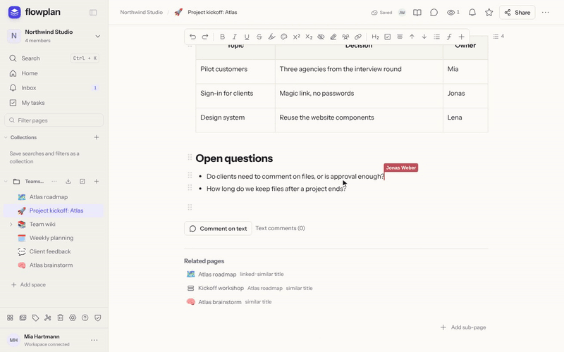

[Website](https://flowplan.org) · [Gehostete Version](https://app.flowplan.org) · [Discord](https://discord.gg/bCEdB6MPrR) · [Änderungen](CHANGELOG.md)

<sub>Die Aufnahme zeigt die englische Oberfläche; Flowplan gibt es auch auf Deutsch.</sub>

</div>

## Inhalt

- [Auf einen Blick](#auf-einen-blick)
- [Schnellstart](#schnellstart)
- [Funktionen](#funktionen) · [Screenshots](#screenshots) · [Flowplan im Vergleich](#flowplan-im-vergleich) · [Datenschutz von Grund auf](#datenschutz-von-grund-auf)
- Genauer hingeschaut: [Schreiben](#schreiben-und-denken) · [Datenbanken](#ordnen-mit-datenbanken) · [KI](#ki-optional) · [Whiteboards und Journal](#whiteboards-und-ein-journal) · [Handschrift](#handschrift-und-notizbücher) · [Startseite](#eine-startseite-nach-deinem-geschmack) · [Gemeinsam](#gemeinsam-überall)
- [Für Admins und Integrationen](#für-admins-und-integrationen): [Architektur](#architektur), [Systemanforderungen](#systemanforderungen), [Sicherheit](#sicherheit)
- [Häufige Fragen](#häufige-fragen)
- [Entwicklung](#entwicklung)
- [Community](#community): [Hilf beim Übersetzen](#hilf-beim-übersetzen), [Mitwirkende](#mitwirkende), [Sterne im Verlauf](#sterne-im-verlauf)
- [Flowplan unterstützen](#flowplan-unterstützen)

## Auf einen Blick

- **Alles in einem Seitenbaum** – Dokumente, Datenbanken mit zehn Ansichten, Whiteboards, Notizbücher für Handschrift, ein tägliches Journal, Projekte mit Tickets und Sprints, Umfragen.
- **Komplett Open Source** unter der AGPL-3.0 – keine geschlossene Enterprise-Version, keine Funktionen hinter einem Lizenzschlüssel.
- **Ein Container mit SQLite** – kein Postgres, kein Redis, kein externer Suchdienst. Oder gehostet in Deutschland auf [app.flowplan.org](https://app.flowplan.org).
- **Optionale KI** – standardmäßig aus; Admins schalten sie pro Funktion und Person ein, komplett lokal mit [Ollama](https://ollama.com) oder mit Schlüssel für OpenAI, Anthropic, Gemini oder jeden OpenAI-kompatiblen Dienst. Du bestimmst, welche Seiten sie lesen darf.
- **Datenschutz von Grund auf** – kein Tracking, Rechte bis auf den einzelnen Eintrag, Zwei-Faktor-Anmeldung, Verschlüsselung von Dateien und Sicherungen mit eigenem Schlüssel.
- **Deine Daten bleiben mitnehmbar** – Markdown mit Frontmatter, CSV und ZIP, geplante Exporte nach S3 oder Git, Import aus Notion, AppFlowy, Obsidian, Jira und Trello.

Die Oberfläche gibt es auf Deutsch, Englisch, Französisch und vereinfachtem Chinesisch – weitere Sprachen lassen sich als JSON-Kataloge ergänzen ([Hilf beim Übersetzen](#hilf-beim-übersetzen)); die Dokumentation ist auf Deutsch und Englisch.

## Schnellstart

Probier Flowplan mit einem einzigen Befehl auf deinem Rechner aus:

```sh
docker run -d --name flowplan -p 3000:3000 -v flowplan:/app/data -e APP_URL=http://localhost:3000 ghcr.io/yannicschuller/flowplan:latest
```

Öffne <http://localhost:3000> und wähle **Konto erstellen** – das erste Konto verwaltet die Instanz. `APP_URL` muss genau die Adresse sein, die du im Browser eintippst: Soll Flowplan von anderen Geräten oder unter einer Domain erreichbar sein, passt du sie an (zum Beispiel `-e APP_URL=https://flowplan.example.com`) und stellst einen Reverse Proxy mit HTTPS davor. Alle Daten liegen im Volume `flowplan`.

<details>
<summary><b>Docker Compose für einen Server</b> – Volume, <code>APP_URL</code> und optional S3</summary>

```yaml
services:
  flowplan:
    image: ghcr.io/yannicschuller/flowplan:latest
    restart: unless-stopped
    ports:
      - "127.0.0.1:3000:3000"   # davor sitzt ein Reverse Proxy mit HTTPS
    environment:
      APP_URL: https://flowplan.example.com
      # Optional: Dateien nach S3 spiegeln und die Datenbank laufend sichern (Litestream)
      # S3_BUCKET: flowplan
      # S3_ENDPOINT: https://s3.example.com
      # S3_REGION: eu-central-1
      # S3_ACCESS_KEY_ID: ...
      # S3_SECRET_ACCESS_KEY: ...
      # Verschlüsselt Dateien im Bucket, Sicherungen und Exporte: openssl rand -base64 32
      # FLOWPLAN_ENCRYPTION_KEY: ...
    volumes:
      - flowplan-data:/app/data

volumes:
  flowplan-data:
```

`docker compose up -d`, dann deine Domain öffnen. Single Sign-on, E-Mail und alle anderen Einstellungen sind ebenfalls Umgebungsvariablen – siehe [Konfiguration](https://docs.flowplan.org/de/configuration).

</details>

Im Repository liegt außerdem eine fertige [`compose.yaml`](compose.yaml) mit Beispielkonfiguration:

```sh
curl -O https://raw.githubusercontent.com/yannicschuller/flowplan/main/compose.yaml
curl -o .env https://raw.githubusercontent.com/yannicschuller/flowplan/main/.env.example
# .env anpassen: mindestens APP_URL (optional OIDC_* und SMTP_*)
docker compose up -d
```

- **Lokale KI (optional):** `docker compose --profile ai up -d` startet Ollama neben Flowplan; `OLLAMA_URL=http://ollama:11434` setzen und unter **Administration → KI** ein Modell wählen ([KI](https://docs.flowplan.org/de/ai)).
- **Kubernetes:** das Helm-Chart in [`deploy/helm/flowplan`](deploy/helm/flowplan/README.md) (ein Pod mit Volume, wie SQLite es braucht).
- **Single Sign-on:** beim OIDC-Anbieter einen vertraulichen Web-Client mit der Weiterleitungsadresse `https://<deine-domain>/api/auth/callback` anlegen ([Anmeldung](https://docs.flowplan.org/de/sign-in)).

Alle Daten liegen im Volume unter `/app/data`. Pro Datenverzeichnis läuft **genau ein** Container (SQLite).

<details>
<summary><b>Images und automatisches Ausrollen</b></summary>

Das Image liegt in der GitHub Container Registry für `linux/amd64` und `linux/arm64`:

```
ghcr.io/yannicschuller/flowplan:latest     # das neueste Release
ghcr.io/yannicschuller/flowplan:1.2.3      # ein festes Release (auch :1.2 und :1)
ghcr.io/yannicschuller/flowplan:beta       # der neueste manuelle Build, nicht für den Betrieb
```

Images entstehen nur bei einem Release oder von Hand: **Actions → Docker image → Run workflow** baut `:beta` aus dem gewählten Branch (mit einer Version baut es stattdessen dieses Release neu). Jedes `:beta`-Image lässt sich automatisch auf Coolify ausrollen: die Repository-Secrets `COOLIFY_WEBHOOK` (Deploy-Webhook der Ressource) und `COOLIFY_TOKEN` (API-Token mit Deploy-Recht) setzen und die Coolify-Ressource das `:beta`-Image nutzen lassen. Siehe [Coolify und Reverse Proxys](https://docs.flowplan.org/de/coolify-and-proxy).

</details>

Mehr in der Dokumentation: [Installation](https://docs.flowplan.org/de/installation) · [Konfiguration](https://docs.flowplan.org/de/configuration) · [Speicher, S3 und Sicherung](https://docs.flowplan.org/de/storage-and-backups) · [Betrieb](https://docs.flowplan.org/de/operations)

## Funktionen

<table>
  <tr>
    <td width="33%" valign="top">📝 <b><a href="https://docs.flowplan.org/de/documents">Dokumente</a></b><br>Ein Block-Editor mit <code>/</code>-Menü, Markdown-Kürzeln, Formeln, Mermaid, Fußnoten und Versionsverlauf.</td>
    <td width="33%" valign="top">🗂️ <b><a href="https://docs.flowplan.org/de/databases">Datenbanken und Ansichten</a></b><br>23 Eigenschaftstypen mit Relationen und Formeln – als Tabelle, Board, Kalender, Zeitleiste, Galerie, Diagramm und mehr.</td>
    <td width="33%" valign="top">🧩 <b><a href="https://docs.flowplan.org/de/whiteboards">Whiteboards</a></b><br>Haftnotizen, Verbinder, Mindmaps und Formenbibliotheken – und Server-<a href="https://docs.flowplan.org/de/whiteboards#racks-und-verkabelung">Racks mit Verkabelung</a>.</td>
  </tr>
  <tr>
    <td valign="top">📔 <b><a href="https://docs.flowplan.org/de/journal">Journal</a></b><br>Eine Seite pro Tag mit Vorlagen, Trackern, Monatsrückblick und optionaler PIN-Sperre.</td>
    <td valign="top">🎯 <b><a href="https://docs.flowplan.org/de/projects-and-tickets">Projekte und Sprints</a></b><br>Tickets wie <code>WEB-123</code>, Epics, Sprints mit Burndown, Automationen und Git-Anbindung.</td>
    <td valign="top">📋 <b><a href="https://docs.flowplan.org/de/forms">Formulare und Umfragen</a></b><br>Formulare auf jeder Datenbank und Umfragen mit 19 Fragetypen – jede Antwort ist ein Eintrag.</td>
  </tr>
  <tr>
    <td valign="top">🔎 <b><a href="https://docs.flowplan.org/de/search-and-notifications">Sammlungen und Suche</a></b><br>Volltextsuche mit Texterkennung für PDFs und Office-Dateien; Suchen und Filter als Sammlungen behalten.</td>
    <td valign="top">✨ <b><a href="https://docs.flowplan.org/de/ai">KI, optional</a></b><br>Aus, bis ein Admin sie einschaltet – lokal mit Ollama oder mit deinem eigenen Schlüssel für OpenAI, Anthropic oder Gemini.</td>
    <td valign="top">🔄 <b><a href="https://docs.flowplan.org/de/migrate">Import und Export</a></b><br>Rein aus Notion, Confluence, AFFiNE, AppFlowy, Obsidian, Evernote und mehr; raus als Markdown, CSV, PDF oder Word.</td>
  </tr>
  <tr>
    <td valign="top">📱 <b><a href="https://docs.flowplan.org/de/offline-and-apps">Apps</a></b><br>Eine installierbare Web-App, die offline funktioniert, Desktop-Apps und Apps für iPhone, iPad und Android.</td>
    <td valign="top">🔐 <b><a href="https://docs.flowplan.org/de/sign-in">Sicherheit</a></b><br>SSO mit OIDC, LDAP und SCIM, Zwei-Faktor-Anmeldung, Passkeys und <a href="https://docs.flowplan.org/de/encrypted-spaces">Ende-zu-Ende-verschlüsselte Bereiche</a>.</td>
    <td valign="top">💾 <b><a href="https://docs.flowplan.org/de/storage-and-backups">Selbst hosten und sichern</a></b><br>Ein Container mit SQLite, laufende Sicherung nach S3 mit Litestream, geplante verschlüsselte Sicherungen, ein Helm-Chart.</td>
  </tr>
</table>

## Screenshots

<table>
  <tr>
    <td width="50%">
      <picture>
        <source media="(prefers-color-scheme: dark)" srcset=".github/assets/readme/screenshot-document-dark.png">
        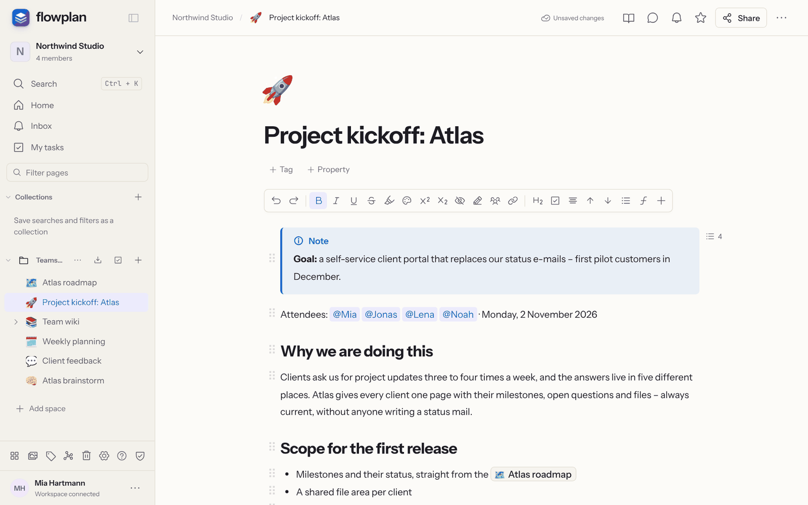
      </picture>
    </td>
    <td width="50%">
      <picture>
        <source media="(prefers-color-scheme: dark)" srcset=".github/assets/readme/screenshot-database-dark.png">
        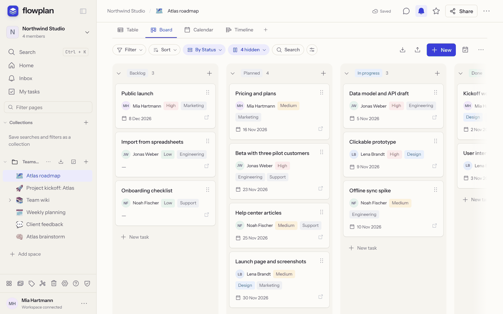
      </picture>
    </td>
  </tr>
  <tr>
    <td><b>Dokumente</b> – ein Projekt-Kickoff mit Hinweisbox, Erwähnungen, Entscheidungstabelle und Links zur Roadmap.</td>
    <td><b>Datenbanken</b> – dieselbe Roadmap als Tabelle, Board, Kalender und Zeitleiste.</td>
  </tr>
  <tr>
    <td>
      <picture>
        <source media="(prefers-color-scheme: dark)" srcset=".github/assets/readme/screenshot-whiteboard-dark.png">
        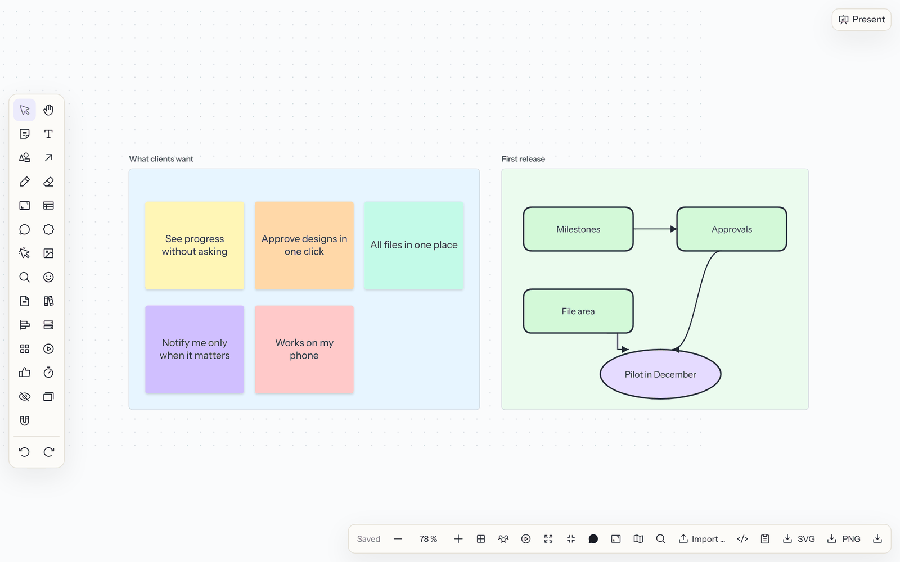
      </picture>
    </td>
    <td>
      <picture>
        <source media="(prefers-color-scheme: dark)" srcset=".github/assets/readme/screenshot-phone-dark.png">
        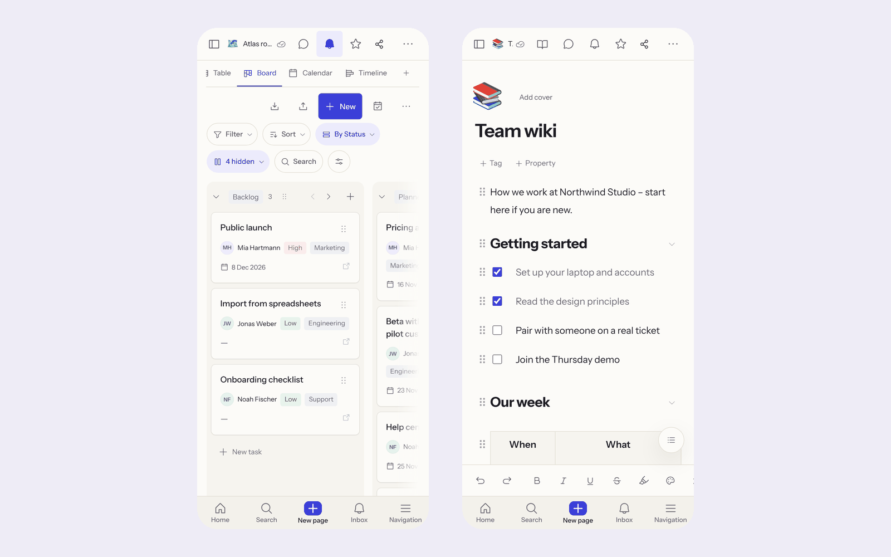
      </picture>
    </td>
  </tr>
  <tr>
    <td><b>Whiteboards</b> – Haftnotizen, Rahmen und Verbinder, live gemeinsam bearbeitet.</td>
    <td><b>Auf dem Telefon</b> – derselbe Arbeitsbereich im Browser oder in den Apps.</td>
  </tr>
</table>

<sub>GitHub zeigt die Screenshots hell oder dunkel, passend zu deinem Design. Die Beispielinhalte sind englisch.</sub>

## Flowplan im Vergleich

Ein fairer Vergleich ist schwer – jedes dieser Werkzeuge kann etwas gut. Das hier ist unsere beste Lesart der Dokumentation der jeweiligen Produkte.

| | Flowplan | Notion | Confluence | AFFiNE | AppFlowy | Outline |
| --- | :---: | :---: | :---: | :---: | :---: | :---: |
| **Selbst hostbar** | ✅ | ❌ | ⚠️ nur Data Center, läuft aus¹ | ✅ | ✅ | ✅ |
| **Open Source** | ✅ | ❌ | ❌ | ✅ | ✅ | ⚠️ Quellcode einsehbar |
| **Lizenz** | AGPL-3.0 | proprietär | proprietär | MIT (Community Edition)² | AGPL-3.0 | BSL 1.1 |
| **Funktioniert offline** | ✅³ | ⚠️ Seiten für offline gespeichert | ❌ | ✅ Local-first | ✅ Local-first | ❌ |
| **Datenbanken** | ✅ 10 Ansichten | ✅ | ⚠️ neu, nur Cloud | ⚠️ Datenbank-Blöcke | ✅ | ❌ |
| **Whiteboards** | ✅ | ❌ nur Einbettungen | ✅ Cloud | ✅ Edgeless-Modus | ⚠️ nicht eingebaut, soweit wir wissen | ❌ |
| **Journal** | ✅ | ⚠️ Vorlagen | ⚠️ Vorlagen | ✅ | ⚠️ Vorlagen | ⚠️ Vorlagen |
| **Ende-zu-Ende-Verschlüsselung** | ⚠️ verschlüsselte Bereiche, nur Dokumente⁴ | ❌ | ❌ | ⚠️ nur lokale Daten, soweit wir wissen | ⚠️ Stand unklar | ❌ |
| **Import aus anderen Tools** | ✅ Notion, Confluence, AFFiNE, AppFlowy, Obsidian, Evernote, Google Docs, Microsoft Word, Jira, Trello | ✅ | ⚠️ wenige Formate | ✅ Notion, Markdown, HTML | ✅ Notion, Markdown, CSV | ✅ Notion, Confluence, Markdown |
| **Apps (iOS / Android / Desktop)** | ⚠️ Desktop und iOS; Android als APK | ✅ | ⚠️ nur mobil | ⚠️ Desktop; mobile Apps noch neu | ✅ | ⚠️ Desktop; mobil im Browser |
| **Echtzeit-Zusammenarbeit** | ✅ | ✅ | ✅ | ✅ | ✅ mit AppFlowy Cloud | ✅ |

<sub>✅ ja · ⚠️ teilweise · ❌ nein. Stand: November 2026, Korrekturen willkommen – bitte [ein Issue öffnen](https://github.com/yannicschuller/flowplan/issues/new/choose).<br>
¹ Atlassian verkauft keine neuen Server-Lizenzen mehr und hat das Ende von Data Center angekündigt. ² Enterprise-Funktionen unter eigener Lizenz. ³ Dokumente und Einträge; verschlüsselte Seiten und Änderungen an Eigenschaften und Ansichten einer Datenbank brauchen eine Verbindung ([Details](https://docs.flowplan.org/de/offline-and-apps#ohne-verbindung-arbeiten)). ⁴ Inhalte und Dateien werden im Browser verschlüsselt, Seitenstruktur und Mitgliederliste nicht ([Details](https://docs.flowplan.org/de/encrypted-spaces)).</sub>

## Datenschutz von Grund auf

- **Kein Tracking** – keine Analyse- oder Werbe-Cookies, keine Profile. Die Statistiken in der Administration sind reine Zahlen (ohne IP-Adressen, Pfade oder Namen) und bleiben auf deiner Instanz ([Betrieb](https://docs.flowplan.org/de/operations#statistik)).
- **Gehostet in Deutschland** – die gehostete Version auf [app.flowplan.org](https://app.flowplan.org) läuft auf Servern in Deutschland. Oder du betreibst Flowplan auf deinem eigenen Server: Es schickt keine Nutzungsdaten irgendwohin, und die Prüfung auf neue Versionen bei GitHub schaltet `FLOWPLAN_UPDATE_CHECK=false` ab.
- **Alles exportierbar** – Markdown mit YAML-Frontmatter, ZIP mit allen Dateien, CSV, HTML/JSON, Word, PDF und EPUB; geplante Exporte nach S3 oder Git ([Import, Export und Versionen](https://docs.flowplan.org/de/import-export-versions)).
- **Open Source unter der AGPL-3.0** – vollständig: keine geschlossene Enterprise-Version, keine Funktionen hinter einem Lizenzschlüssel.

## Schreiben und denken

Ein Block-Editor, der nicht im Weg steht. `/` öffnet das Blockmenü, Markdown-Kürzel funktionieren auch; lange Seiten behalten ihr Inhaltsverzeichnis neben dem Text.

<p align="center">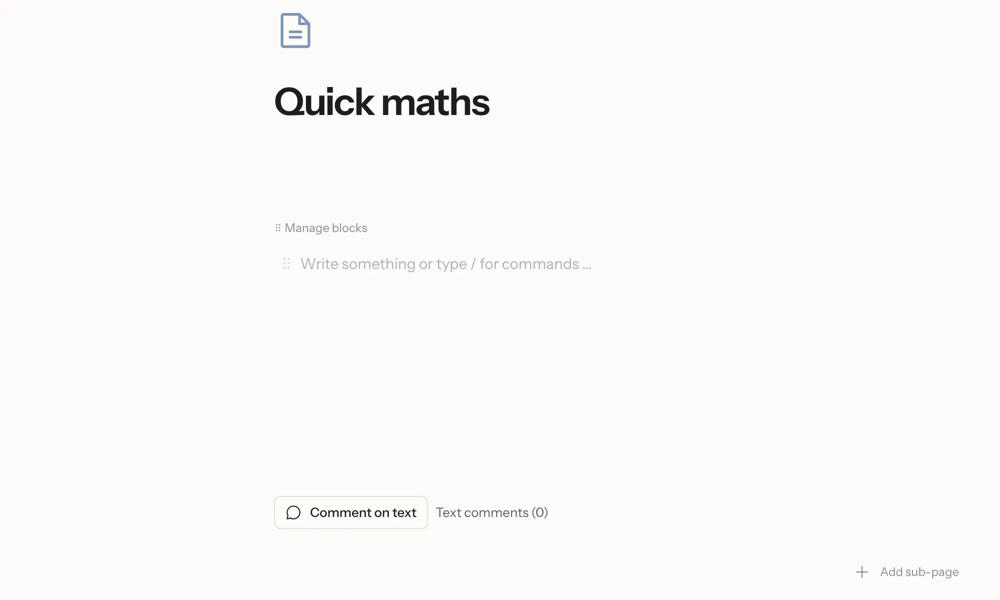</p>

**Rechnen direkt in den Notizen** – Rechnung und `=` tippen, mit <kbd>Tab</kbd> übernehmen; Terme ausmultiplizieren, faktorisieren oder lösen, Funktionsgraphen und Vektoren in 2D und 3D zeichnen.

<details>
<summary><b>Alles im Editor</b></summary>

- Überschriften, Listen, Aufgaben mit Person und Fälligkeit, Tabellen, Code mit Hervorhebung, Mermaid-Diagramme, KaTeX-Formeln
- Hinweise wie GitHub-Alerts, Aufklapper, bis zu drei Spalten, Einbettungen und Linkkarten, synchronisierte Blöcke
- **Fußnoten**, **Zitate mit Literaturverzeichnis** (DOI, BibTeX, Zotero), im Markdown-Export im Pandoc-Format
- **Seite als Markdown bearbeiten** und in einem Schritt übernehmen
- **Autoren anzeigen** – wer was geschrieben hat, farbig
- Text von rechts nach links für Arabisch, Hebräisch und Persisch
- Sprachnotizen mit Transkription, Fotos markieren, Fokusmodus mit Wortziel
- Versionsverlauf mit Vergleich und Wiederherstellen einzelner Absätze, Druck- und PDF-Layout
- Antworten aus ChatGPT behalten beim Einfügen Formeln, Listen und Tabellen

</details>

## Ordnen mit Datenbanken

Tabelle, Board, Kalender, Timeline, Galerie, Liste, Feed, Diagramm, Formular und Sprints auf dieselben Einträge – mit Relationen, Rollups und Formeln.

<p align="center">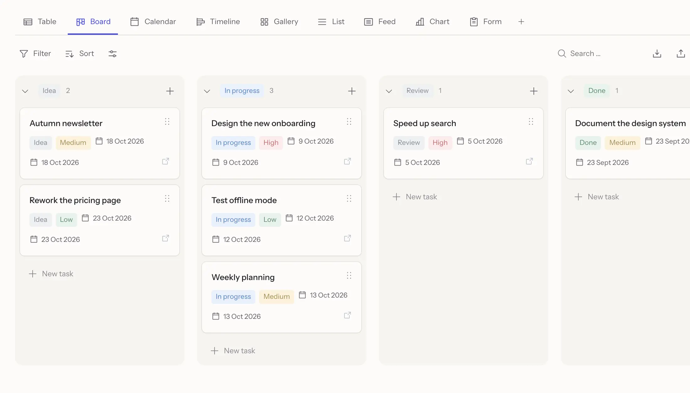</p>

<table>
  <tr>
    <td width="50%">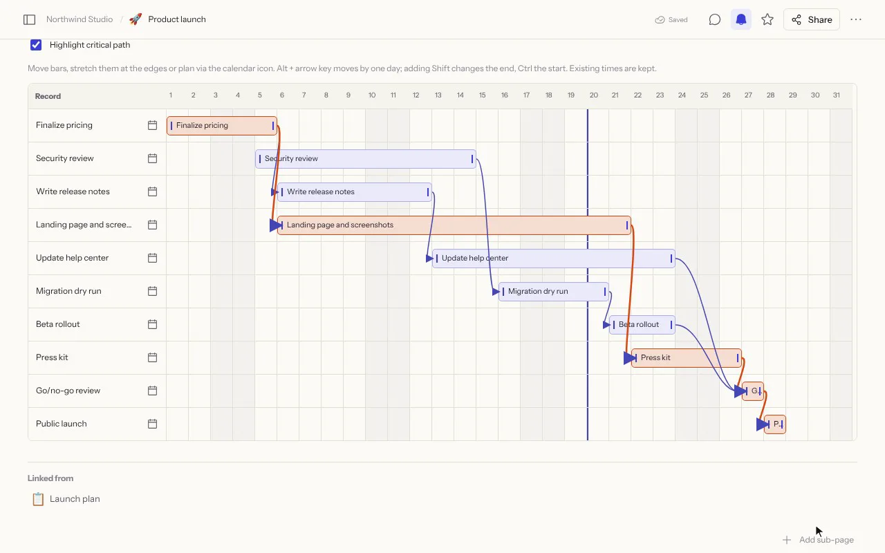</td>
    <td width="50%">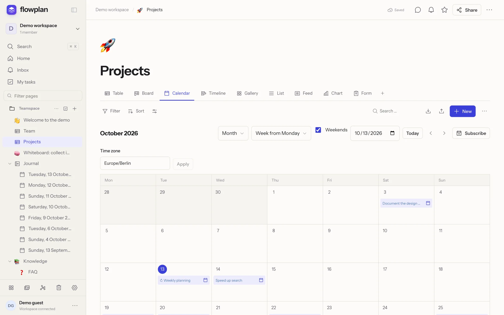</td>
  </tr>
  <tr>
    <td><b>Timeline</b> – Gantt mit Abhängigkeiten, kritischem Pfad und Nachfolgern, die mitrücken.</td>
    <td><b>Kalender</b> – in Apple, Google oder Outlook abonnieren oder per CalDAV in beide Richtungen.</td>
  </tr>
</table>

<details>
<summary><b>Alles in Datenbanken</b></summary>

- 23 Eigenschaftstypen, darunter Formel, Relation, Rollup und **KI-Eigenschaft**
- Filtergruppen, Sortierung, Gruppen in drei Ebenen, Swimlanes, Berechnungen je Spalte
- Wiederholungen und Erinnerungen, Eintragsvorlagen, Eintragsseiten mit eigenem Layout, Rechte pro Eintrag
- **Projekte und Tickets** (optional, pro Datenbank): Ticketnummern wie `WEB-123` im Text verlinkt, Unteraufgaben und Epics, Sprints mit Backlog, Burndown und Velocity, Automationen, Status-Workflows, WIP-Limits, Zeiterfassung, Git-Anbindung für GitHub, GitLab und Gitea, Dashboards
- **Umfragen** mit 19 Fragetypen, Bedingungen und Auswertung – jede Antwort ist ein Eintrag
- Import aus CSV, Jira und Trello; Markdown mit YAML-Frontmatter in beide Richtungen (passt zu Obsidian)

</details>

## KI, optional

KI ist in Flowplan **aus, bis ein Admin sie einschaltet** – und dann nur für die Funktionen und Personen, die er wählt. Sie läuft **komplett lokal mit Ollama**, sodass kein Text den Server verlässt, oder mit einem Schlüssel für OpenAI, Anthropic, Gemini oder jeden OpenAI-kompatiblen Dienst. Admins können stattdessen auch jede Person ihren eigenen Schlüssel mitbringen lassen.

<p align="center">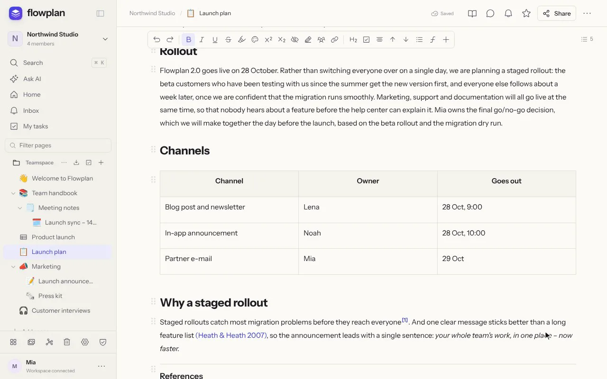</p>

<table>
  <tr>
    <td width="50%">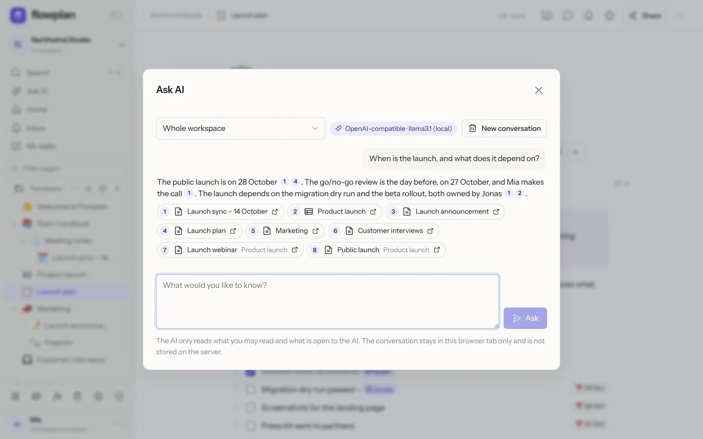</td>
    <td width="50%">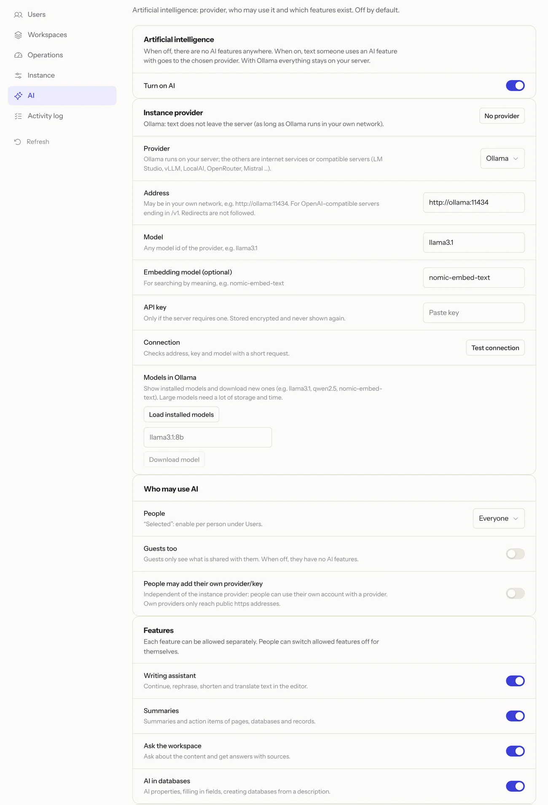</td>
  </tr>
  <tr>
    <td><b>Fragen an den Arbeitsbereich</b> – Antworten mit Links zu ihren Quellen, nie mehr, als du lesen darfst.</td>
    <td><b>Unter deiner Kontrolle</b> – Anbieter, Personen und jede Funktion einzeln einschaltbar.</td>
  </tr>
</table>

- **Schreibassistent** – verbessern, umformulieren, kürzen, erweitern, übersetzen, Ton ändern oder frei schreiben lassen (<kbd>⌘</kbd> <kbd>J</kbd>, `/ki`).
- **Zusammenfassungen** von Seiten, Datenbankansichten, Einträgen und Sprachnotizen – mit Kernpunkten und offenen Aufgaben.
- **Fragen an den Arbeitsbereich** – Volltext und auf Wunsch Suche nach Bedeutung mit Embeddings.
- **KI in Datenbanken** – KI-Eigenschaften, die sich selbst füllen, Felder ausfüllen, Datenbanken aus einer Beschreibung anlegen.
- **Du bestimmst, was sie liest** – Arbeitsbereiche, Bereiche oder Seiten für dich ausschließen; Verwaltende sperren Seiten für alle. Journale mit PIN und private Einträge liest sie nie.
- **Schlüssel bleiben geheim** – verschlüsselt gespeichert, nie wieder angezeigt, an die Adresse des Anbieters gebunden.

Mehr unter [KI in der Dokumentation](https://docs.flowplan.org/de/ai).

## Whiteboards und ein Journal

<table>
  <tr>
    <td width="50%">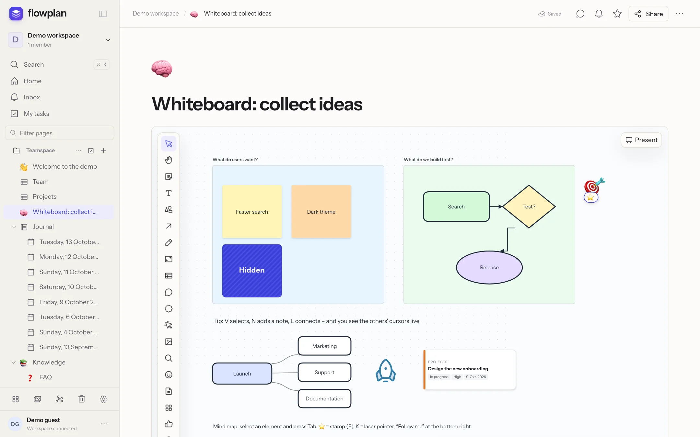</td>
    <td width="50%">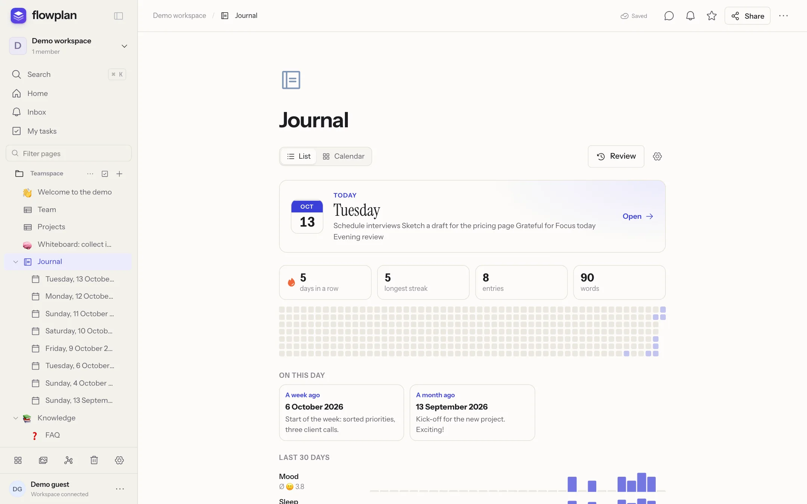</td>
  </tr>
  <tr>
    <td><b>Whiteboards</b> – Notizzettel, Formen, Verbinder, Rahmen, Mindmaps, Abstimmungen, Timer, Präsentationsmodus, Import aus Excalidraw und draw.io.</td>
    <td><b>Journal</b> – eine Seite pro Tag mit Vorlagen, Trackern, Rückblick, Erinnerungen und optionaler PIN-Sperre.</td>
  </tr>
</table>

## Handschrift und Notizbücher

Schreiben mit dem Apple Pencil, einem anderen Tablet-Stift, der Maus oder dem Finger – in Notizbüchern, auf PDFs und mitten im Dokument.

<p align="center">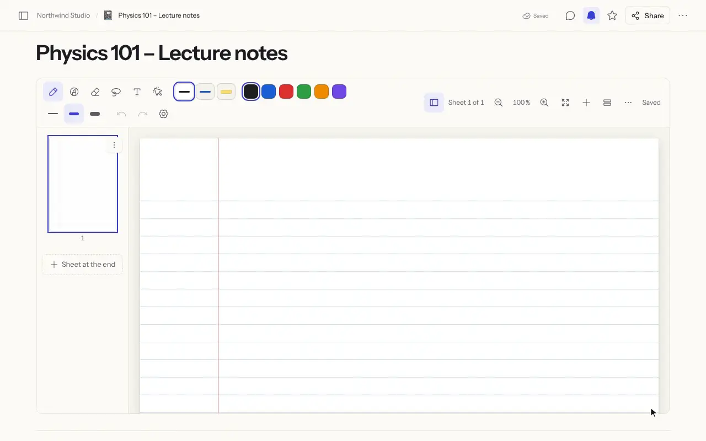</p>

**Notizbücher** sind eine eigene Seitenart: Blätter mit leerem, liniertem, kariertem, gepunktetem, Cornell- oder Notenpapier, A4 oder Letter, hell oder dunkel, mit Vorschauen zum Springen und Umsortieren. Ein PDF öffnet sich als Notizbuch zum Beschreiben Seite für Seite, und jedes Notizbuch lässt sich als PDF exportieren – die Handschrift als Vektoren.

<picture>
  <source media="(prefers-color-scheme: dark)" srcset=".github/assets/readme/notebook-ipad-dark.webp">
  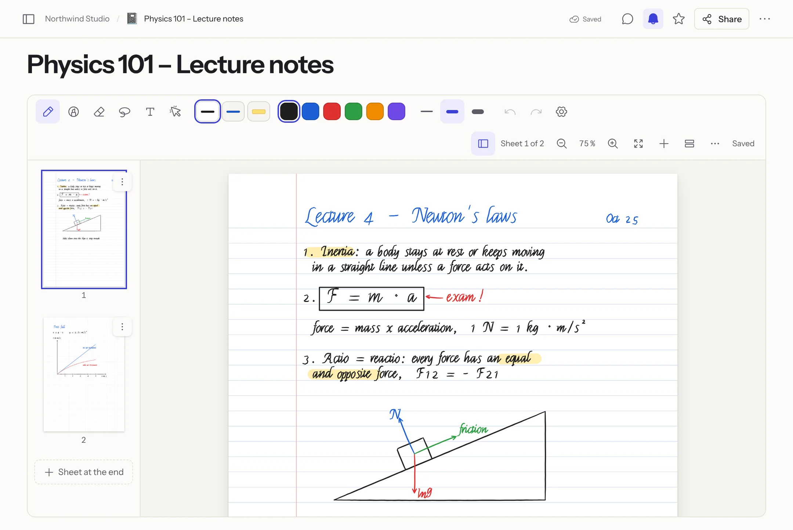
</picture>

<table>
  <tr>
    <td width="50%">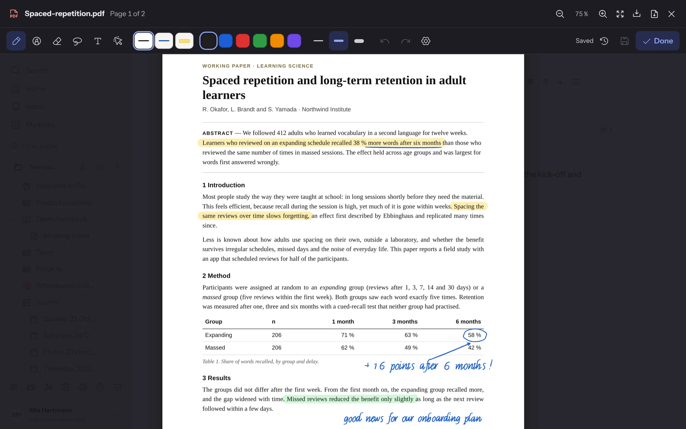</td>
    <td width="50%">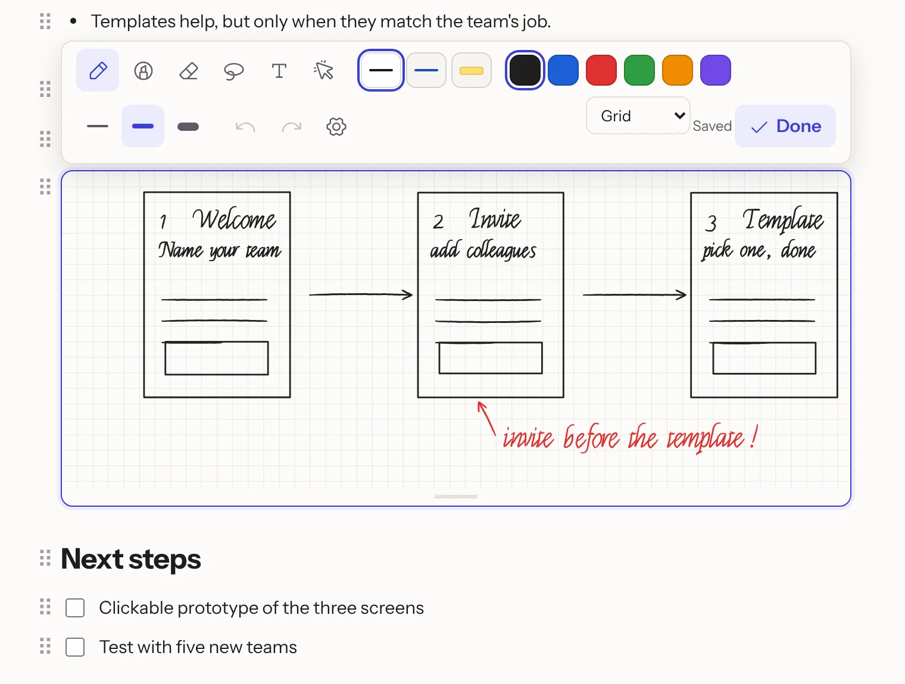</td>
  </tr>
  <tr>
    <td><b>Auf PDFs schreiben</b> – Textmarker und Stift direkt im Viewer; jedes Speichern ist eine Version, und das PDF lässt sich mit den Anmerkungen herunterladen.</td>
    <td><b>Zeichenblöcke</b> – <code>/zeichnen</code> setzt eine Skizze zwischen die Absätze eines Dokuments; was mehrere gleichzeitig zeichnen, wird zusammengeführt statt überschrieben.</td>
  </tr>
</table>

- Stift mit Druckstärke, Textmarker, Radierer für ganze Striche oder Teile, Lasso zum Verschieben, Skalieren und Umfärben, Text und Laserpointer; drei Lieblingsstifte
- Den Stift am Ende eines Strichs kurz ruhig halten – der Strich rastet zur geraden Linie, zum Rechteck, zur Ellipse, zum Dreieck oder zur Raute ein
- Sobald du mit einem Stift schreibst, zeichnet nur noch der Stift: Finger scrollen und zoomen, eine aufliegende Hand hinterlässt keine Spuren
- In der App für iPhone und iPad wird Handschrift auf dem Gerät erkannt: Die Suche findet sie, und **In Text umwandeln** macht aus ausgewählten Strichen getippten Text

Mehr unter [Notizbücher und Handschrift](https://docs.flowplan.org/de/notebooks).

## Eine Startseite nach deinem Geschmack

<p align="center">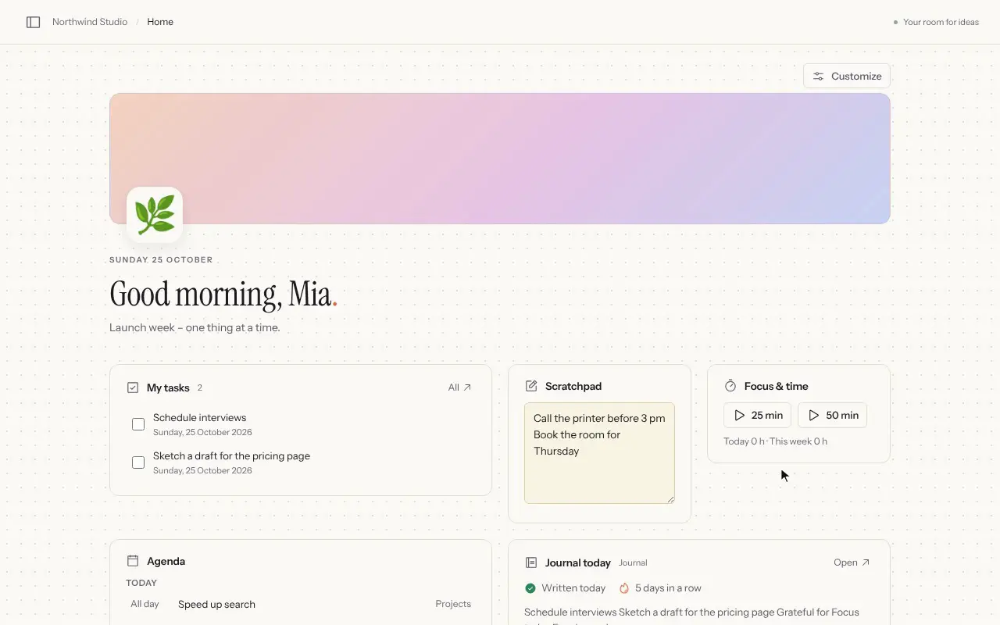</p>

Stell die Startseite aus 20 Widgets zusammen – Aufgaben zum Abhaken, Termine, Journal heute, Fokus-Timer, Gewohnheiten, Zähler, Notizzettel, eine Datenbankansicht, Links und mehr. Ziehen, Größe ändern und einstellen, pro Arbeitsbereich; dazu ein Kopfbereich mit Farbe, Verlauf oder Cover, ein Emoji, Abstände und ein Hintergrund. Eigentümer legen den Standard für ihre Mitglieder fest. Mehr unter [Startseite anpassen](https://docs.flowplan.org/de/first-steps#startseite-anpassen).

## Gemeinsam, überall

Gleichzeitig bearbeiten mit Live-Cursorn (Yjs/CRDT), Kommentare und Textkommentare, Erwähnungen, Reaktionen, Änderungsvorschläge, ein Posteingang, E-Mail-Zusammenfassungen und Web-Push. Teile eine Seite mit einer einzelnen Person, mit Gästen über Links (auf Wunsch mit **Passwort und Ablaufdatum**), veröffentliche sie im Web oder mach ein Formular daraus. Flowplan lässt sich als App installieren und funktioniert offline; Desktop-Apps für macOS, Windows und Linux gibt es unter [flowplan.org/download](https://flowplan.org/download) – mit Schnell erfassen aus jeder App (Kürzel wie `morgen 15 Uhr #kunde @anna !hoch`, Links, Dateien, Bildschirmausschnitte und Sprachnotizen, Warteschlange ohne Verbindung; [Doku](https://docs.flowplan.org/de/desktop-capture)). Für **iPhone und iPad gibt es die App im [App Store](https://apps.apple.com/app/id6825801344)**, für **Android eine App zum [Herunterladen](https://flowplan.org/download/android.apk)** ohne Play Store (sie aktualisiert sich selbst) – mit Widgets, Knöpfen an Benachrichtigungen, Siri und Kurzbefehlen, Teilen aus anderen Apps, dem Apple Pencil und Fenstern auf dem iPad ([Apps](https://docs.flowplan.org/de/offline-and-apps#apps-fuer-iphone-ipad-und-android)). Ihre Benachrichtigungen laufen über das quelloffene [Flowplan-Push-Relay](https://github.com/yannicschuller/flowplan-push), Ende-zu-Ende-verschlüsselt: Sie zeigen ihren Text, während Relay, Apple und Google nur Chiffretext sehen.

<p align="center">
  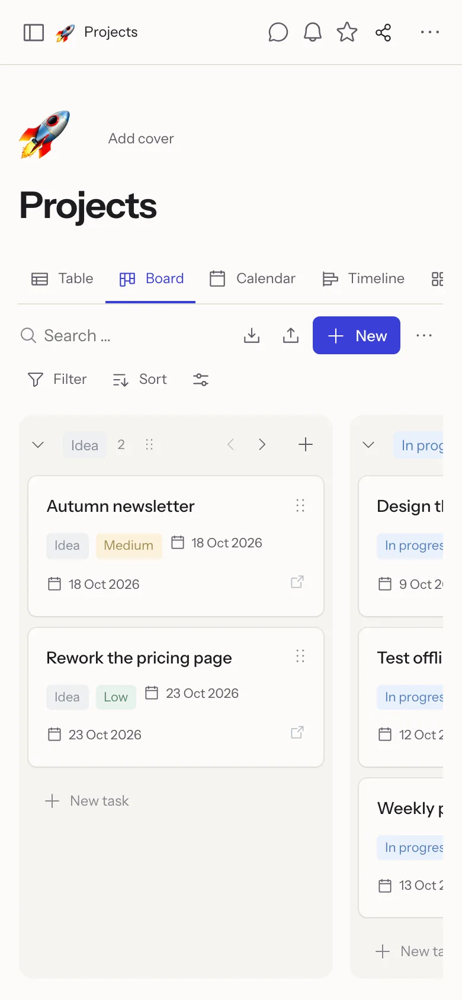
  &nbsp;
  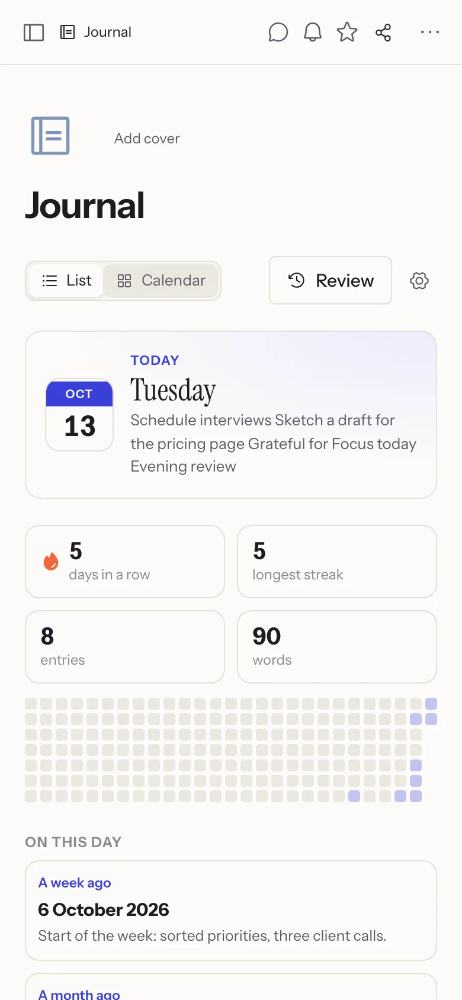
</p>

## Für Admins und Integrationen

### Architektur

<picture>
  <source media="(prefers-color-scheme: dark)" srcset=".github/assets/readme/architecture-de-dark.png">
  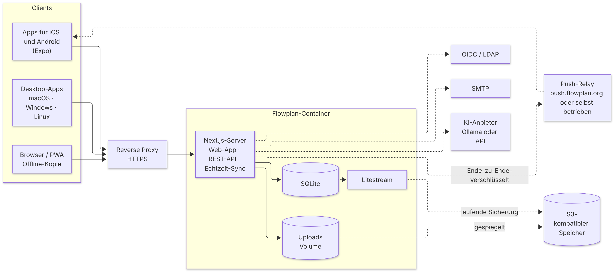
</picture>

Gestrichelte Linien sind optional. Alles, was Flowplan speichert, liegt in einem Datenverzeichnis (`/app/data`): die SQLite-Datenbank, Uploads und Schlüssel. Das [Push-Relay](https://github.com/yannicschuller/flowplan-push) trägt nur Benachrichtigungen an die mobilen Apps aus und sieht dabei nur Chiffretext.

### Systemanforderungen

| | |
| --- | --- |
| **Arbeitsspeicher und CPU** | Für ein kleines Team sind die Vorgaben des Helm-Charts ein guter Anhaltspunkt: 256 MB RAM angefordert, bis zu 1 GB, ein Bruchteil einer CPU. Texterkennung für gescannte PDFs und große Importe brauchen kurz mehr CPU. |
| **Plattformen** | Docker-Images für `linux/amd64` und `linux/arm64`; Kubernetes mit dem [Helm-Chart](deploy/helm/flowplan/README.md) |
| **Speicher** | Ein dauerhaftes Volume (Block- oder lokaler Speicher, kein NFS – SQLite), optional S3-kompatibler Speicher |
| **Netz** | Eine Domain mit HTTPS über einen Reverse Proxy; `http://` reicht zum Testen im eigenen Netz ([ohne HTTPS](https://docs.flowplan.org/de/installation#ohne-https)) |
| **Browser** | Aktuelle Versionen von Chrome, Edge und Firefox (ab 111) sowie Safari ab 16.4 |
| **Ohne Docker** | Node.js 22.13 oder neuer (das Image nutzt Node 26) |

Pro Datenverzeichnis läuft **genau ein** Container – SQLite wird nicht zwischen Replikaten geteilt.

### Sicherheit

Sicherheitslücken bitte vertraulich melden – wie, was dazugehört und welche Versionen Korrekturen bekommen, steht in [SECURITY.md](SECURITY.md).

### Funktionen für Admins

<details open>
<summary><b>Anmeldung und Sicherheit</b></summary>

- E-Mail und Passwort, Passkeys (WebAuthn), **Zwei-Faktor-Anmeldung mit Authenticator-App** (für alle oder nur Admins erzwingbar)
- Single Sign-on mit OpenID Connect; **SSO-Gruppen steuern Rollen und Gruppen** in Arbeitsbereichen
- Rechte pro Bereich, Seite und Eintrag; Gäste; Aktivitätsprotokoll; Sitzungsverwaltung
- Verschlüsselung von Dateien, Sicherungen und Exporten mit eigenem Schlüssel; Geheimnisse wie KI-Schlüssel verschlüsselt gespeichert

</details>

<details>
<summary><b>Betrieb</b></summary>

- Grenzen pro Arbeitsbereich und pro Person (Speicher, eigene Arbeitsbereiche, Uploadgröße)
- Laufende Sicherung nach S3 mit Litestream, geplante Sicherungen und Markdown-Exporte nach S3 oder Git
- Volltextsuche inklusive Texterkennung für gescannte PDFs und Office-Dateien
- Prometheus-Metriken und Health-Endpunkt; **Einstellungen → Über Flowplan** zeigt laufende Version, Commit und Build-Datum und meldet Admins eine neuere Version
- Eine ganze Instanz auf einen anderen Server umziehen unter **Administration → Speicher & Sicherung**: Der neue Server holt Datenbank, Dateien und Schlüssel direkt vom alten, mit kurzer Schlusssynchronisierung im Nur-Lesen-Modus
- `FLOWPLAN_SOURCE_URL` lässt die Quellcode-Links auf deinen geänderten Code zeigen (AGPL §13); `FLOWPLAN_HIDE_SPONSOR=true` blendet die Sponsoring-Karte auf der Seite „Über Flowplan“ aus
- Docker-Image für `amd64` und `arm64`, ein **Helm-Chart** für Kubernetes

</details>

<details>
<summary><b>Integrationen</b></summary>

- REST-API mit Lese- oder Schreib-Tokens, signierte Webhooks
- **OpenAPI**-Beschreibung jeder Instanz (`/api/openapi.json`, lesbar unter `/api/docs`; für Angemeldete und API-Tokens, öffentlich mit `FLOWPLAN_PUBLIC_API_DOCS=true`) mit generierten [TypeScript- und Python-Clients](sdk/)
- **n8n-Community-Knoten** (`n8n-nodes-flowplan`)
- [MCP-Server](https://docs.flowplan.org/de/mcp) für Claude, ChatGPT und andere Assistenten – nur mit den Rechten der jeweiligen Person
- Kalender-Abos und CalDAV in beide Richtungen, Git-Anbindung, Web-Clipper
- Import aus Notion, AppFlowy, Obsidian, Markdown, HTML, CSV, Jira und Trello ([Umzugsanleitung](https://docs.flowplan.org/de/migrate))

</details>

## Häufige Fragen

<details>
<summary><b>Funktioniert Flowplan offline?</b></summary>

Ja. Dokumente werden immer zuerst im Browser gespeichert und abgeglichen, sobald der Server erreichbar ist. Mit **Einstellungen → Offline & Geräte** behält das Gerät die ganze App und alle lesbaren Seiten und Einträge, sodass du ohne Verbindung lesen und bearbeiten kannst; Änderungen an Einträgen werden danach Feld für Feld zusammengeführt. Verschlüsselte Seiten und Änderungen an Eigenschaften und Ansichten einer Datenbank brauchen eine Verbindung. Siehe [Ohne Verbindung arbeiten](https://docs.flowplan.org/de/offline-and-apps#ohne-verbindung-arbeiten).

</details>

<details>
<summary><b>Wie ziehe ich von Notion, Confluence, AFFiNE oder Obsidian um?</b></summary>

Unter **Einstellungen → Import & Export → Import**: Exporte aus Notion und Confluence, die AFFiNE-Arbeitsbereichsdatei, Obsidian-Vaults (als Seiten oder als Datenbank), dazu AppFlowy, Evernote, Google Docs, Microsoft Word (.docx), Markdown, HTML und CSV. Eine Vorschau zeigt, was importiert wird, bevor etwas angelegt wird. Siehe [Umzug zu Flowplan](https://docs.flowplan.org/de/migrate).

</details>

<details>
<summary><b>Gibt es Apps?</b></summary>

Flowplan lässt sich auf jedem Gerät aus dem Browser als App installieren. Desktop-Apps für macOS, Windows und Linux sowie die Android-App gibt es auf [flowplan.org/download](https://flowplan.org/download); die App für iPhone und iPad gibt es im [App Store](https://apps.apple.com/app/id6825801344). Sie verbinden sich mit jeder Instanz, auch mit selbst gehosteten. Siehe [Apps](https://docs.flowplan.org/de/offline-and-apps#apps-fuer-iphone-ipad-und-android).

</details>

<details>
<summary><b>Wie sichere ich meine Daten?</b></summary>

Sichere das Volume `/app/data` – oder lass Flowplan das erledigen: geplante Sicherungen und Markdown-Exporte nach S3 oder Git und, mit S3, eine laufende Kopie der Datenbank mit Litestream, auf Wunsch mit deinem eigenen Schlüssel verschlüsselt. Siehe [Speicher, S3 und Sicherungen](https://docs.flowplan.org/de/storage-and-backups).

</details>

<details>
<summary><b>Wie ziehe ich auf einen anderen Server um?</b></summary>

Starte auf dem neuen Server eine frische Installation und nutze **Administration → Speicher & Sicherung → Instanz umziehen**: Die alte Instanz gibt einen einmaligen Umzugs-Token aus, die neue holt Datenbank, Uploads und Schlüsseldateien direkt von Server zu Server; die Ausfallzeit ist nur die Schlusssynchronisierung, meist wenige Minuten. Alternativ kopierst du das Datenvolume auf den neuen Host und startest dort dasselbe Image – oder startest mit denselben `S3_*`-Variablen und leerem Volume; Litestream stellt die Datenbank wieder her. Siehe [Instanz umziehen](https://docs.flowplan.org/de/move-instance) und [Wiederherstellen](https://docs.flowplan.org/de/storage-and-backups#wiederherstellen).

</details>

<details>
<summary><b>Gibt es KI, und wohin gehen meine Daten?</b></summary>

Nur, wenn ein Admin sie einschaltet – und dann pro Funktion und Person. Mit [Ollama](https://ollama.com) auf deinem eigenen Server verlässt nichts den Server; mit OpenAI, Anthropic, Gemini oder einem anderen OpenAI-kompatiblen Dienst gehen der markierte Text und – wo du es willst – die Seite an diesen Anbieter. Jedes KI-Fenster nennt den Anbieter, und die KI liest nie mehr, als du sehen darfst. Siehe [KI](https://docs.flowplan.org/de/ai#wohin-die-daten-gehen).

</details>

<details>
<summary><b>Kann ich Single Sign-on nutzen?</b></summary>

Ja: OpenID Connect (Keycloak, Authentik, Zitadel, Entra ID …) mit Gruppen, die Rollen und Arbeitsbereiche steuern, Anmeldung über LDAP oder Active Directory und Bereitstellung per SCIM. Passkeys und Zwei-Faktor-Anmeldung funktionieren mit und ohne SSO. Siehe [Anmeldung](https://docs.flowplan.org/de/sign-in).

</details>

## Entwicklung

Node.js 22.13 oder neuer (Docker-Image und CI nutzen Node 26).

```sh
npm ci
cp .env.example .env.local
npm run dev        # http://127.0.0.1:3000
```

Im Entwicklungsmodus gibt es zusätzlich **Lokalen Arbeitsbereich öffnen**, ein gemeinsames lokales Beispielkonto. Im Produktionsmodus gibt es diesen Zugang nicht.

| Befehl | Wirkung |
| --- | --- |
| `npm run dev` | Entwicklungsserver |
| `npm run build` / `npm start` | Produktions-Build und -Server |
| `npm run typecheck` | TypeScript |
| `npm test` | Kerntests (Node-Testrunner, temporäre Datenverzeichnisse, die danach entfernt werden) |
| `npm run test:e2e` | Browsertests (Playwright, Desktop und Handy); einen Server mit eigenem `FLOWPLAN_DATA_DIR` starten und `TEST_BASE_URL` setzen |
| `npm run check:standalone` | Startet den Standalone-Build wie im Container und prüft Health, Persistenz und Wiederherstellung |
| `npm run quality` | Budgets für Barrierefreiheit und Leistung am Produktions-Build: Anmeldung und ein Arbeitsbereich mit Beispielinhalten bei 1280 und 390 px – keine ernsten axe-Befunde, nichts Fokussierbares in `aria-hidden`, kein waagerechtes Scrollen, JavaScript (gzip) und LCP im Budget |
| `npm run test:visual` | Bildschirmfotos wichtiger Ansichten gegen die Vorlagen in `tests/visual/__screenshots__` (`npm run test:visual:update` schreibt neue); nicht Teil von `npm test` |

Stack: Next.js 16 (App Router), React 19, TypeScript, SQLite (`node:sqlite`), TipTap/ProseMirror mit Yjs, Zod und Playwright. Die Dokumentation liegt in [flowplan-docs](https://github.com/yannicschuller/flowplan-docs) (docs.flowplan.org), die Website in [flowplan-website](https://github.com/yannicschuller/flowplan-website) (flowplan.org), die Desktop-Apps in [flowplan-desktop](https://github.com/yannicschuller/flowplan-desktop); dieses Repository enthält die App, das Helm-Chart (`deploy/helm`) und den n8n-Knoten (`integrations/n8n`).

## Community

Fragen, Ideen, zeigen, was ihr gebaut habt, oder einfach Hallo sagen: Kommt in den **[Flowplan-Discord](https://discord.gg/bCEdB6MPrR)**. Fehler und Funktionswünsche am besten als [GitHub-Issue](https://github.com/yannicschuller/flowplan/issues) melden, damit nichts verloren geht.

### Hilf beim Übersetzen

Deutsch und Englisch stehen direkt im Code; jede weitere Sprache ist ein JSON-Katalog in [`locales/`](locales), der den englischen Text auf seine Übersetzung abbildet – fehlt ein Eintrag, erscheint einfach Englisch, sodass eine Sprache Schritt für Schritt wachsen kann. Übernimm einen bestehenden Katalog oder fang einen neuen an: [Eine Sprache hinzufügen](https://docs.flowplan.org/de/languages#eine-sprache-hinzufuegen) erklärt es in wenigen Schritten, und jedes Übersetzungswerkzeug, das JSON versteht, funktioniert.

<!-- i18n:start -->
| Sprache | Code | Übersetzt | Stand |
| --- | --- | ---: | --- |
| 🇩🇪 Deutsch (im Code) | `de` | 8.921 / 8.921 |  |
| 🇬🇧 English (im Code) | `en` | 8.921 / 8.921 |  |
| 🇫🇷 Français | `fr` | 8.921 / 8.921 |  |
| 🇨🇳 简体中文 | `zh` | 8.620 / 8.921 |  |

<sub>Erzeugt mit `npm run i18n:readme` aus `locales/`.</sub>
<!-- i18n:end -->

### Mitwirkende

<a href="https://github.com/yannicschuller/flowplan/graphs/contributors">
  
</a>

### Sterne im Verlauf

<a href="https://www.star-history.com/#yannicschuller/flowplan&Date">
  <picture>
    <source media="(prefers-color-scheme: dark)" srcset="https://api.star-history.com/svg?repos=yannicschuller/flowplan&type=Date&theme=dark" />
    <source media="(prefers-color-scheme: light)" srcset="https://api.star-history.com/svg?repos=yannicschuller/flowplan&type=Date" />
    
  </picture>
</a>

## Flowplan unterstützen

Flowplan entsteht in der Freizeit. Wenn es dir hilft, unterstützt [Sponsoring auf GitHub](https://github.com/sponsors/yannicschuller) bei Servern und dem Apple-Entwicklerkonto – und schafft Zeit für neue Funktionen. Sponsoring ist nichts für dich? Ein Stern fürs Repository, gemeldete Fehler, [Übersetzungen](#hilf-beim-übersetzen) und Weitererzählen helfen genauso. Danke!

## Mitmachen, Sicherheit und Lizenz

Beiträge sind willkommen – siehe [CONTRIBUTING.md](CONTRIBUTING.md). Sicherheitslücken bitte vertraulich melden, wie in [SECURITY.md](SECURITY.md) beschrieben.

Flowplan ist freie Software unter der [GNU Affero General Public License v3.0](LICENSE). Wer eine veränderte Fassung als Netzdienst betreibt, muss den Quellcode den Nutzenden zugänglich machen. Der n8n-Knoten in `integrations/n8n` steht unter der MIT-Lizenz, wie n8n es für Community-Knoten verlangt.

---

<div align="center">
<sub>Freie Software unter der <a href="LICENSE">GNU AGPL-3.0</a> · mit ♥ in Deutschland gemacht · <a href="https://github.com/sponsors/yannicschuller">♥ Sponsern</a></sub>
</div>
