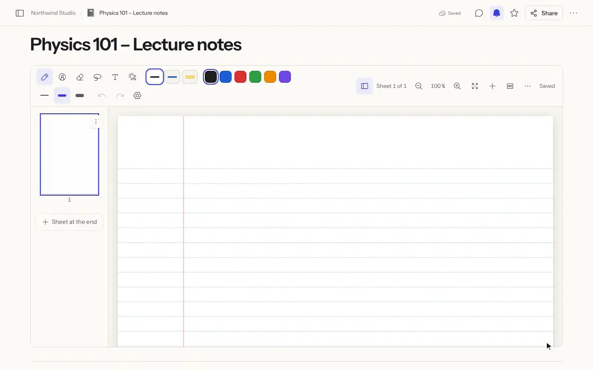
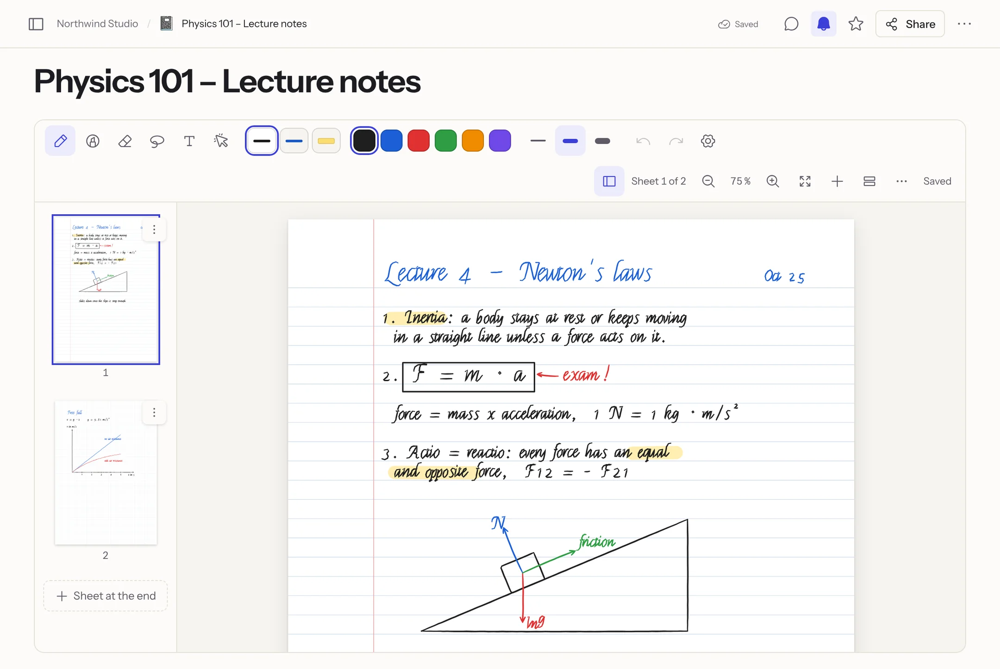
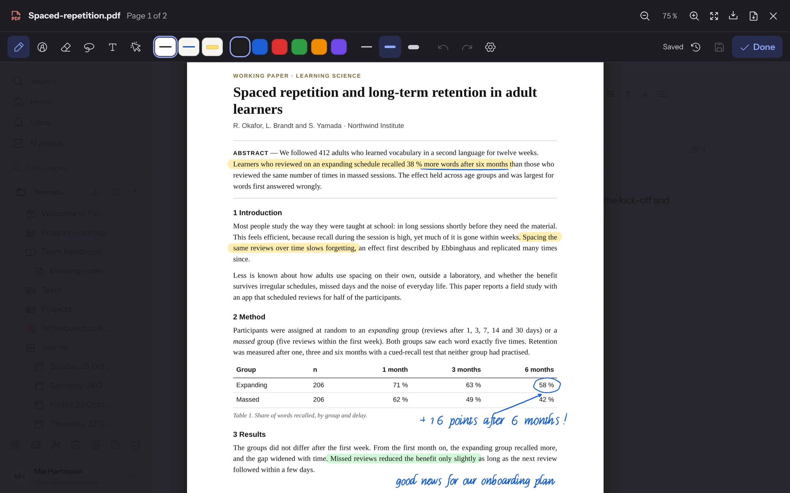
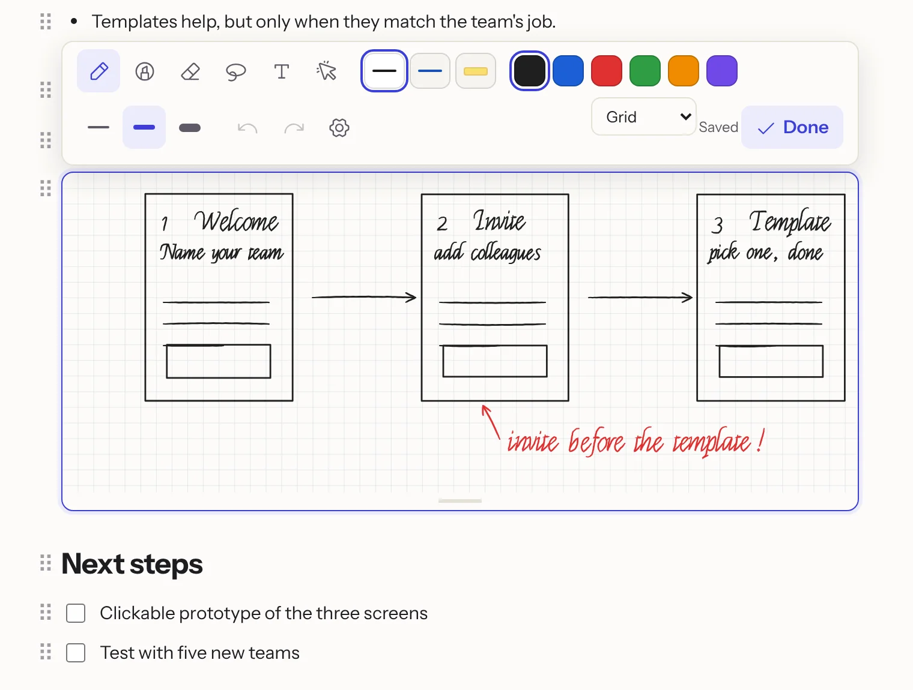
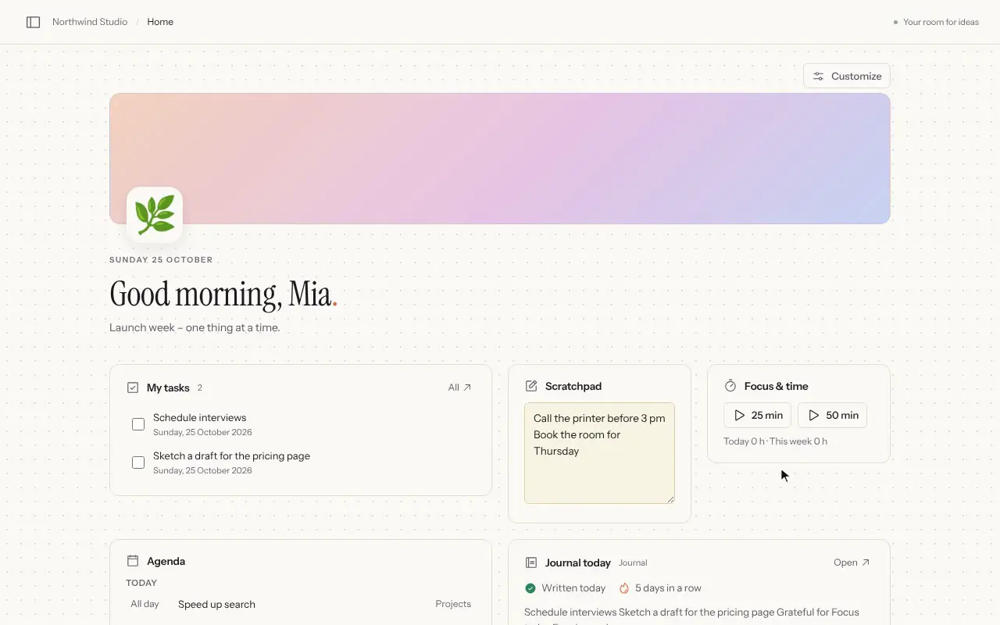

<div align="center">


# Flowplan

**Dokumente, Datenbanken, Whiteboards und ein tägliches Journal für Teams.**<br>
Open Source, selbst gehostet in einem Container – oder gehostet in Deutschland. KI optional, auch komplett lokal.

[English](README.md) · **Deutsch**

[Website](https://flowplan.org) · [Dokumentation](https://docs.flowplan.org/de) · [Selbst hosten](https://docs.flowplan.org/de/installation) · [Gehostete Version](https://app.flowplan.org) · [Discord](https://discord.gg/bCEdB6MPrR) · [Änderungen](CHANGELOG.md)

[](https://github.com/yannicschuller/flowplan/actions/workflows/ci.yml)
[](https://github.com/yannicschuller/flowplan/pkgs/container/flowplan)
[](https://discord.gg/bCEdB6MPrR)
[](LICENSE)

<br>

<picture>
  <source media="(prefers-color-scheme: dark)" srcset=".github/assets/readme/hero-dark.webp">
  
</picture>

</div>

## Auf einen Blick

- **Alles in einem Seitenbaum** – Dokumente, Datenbanken mit zehn Ansichten, Whiteboards, Notizbücher für Handschrift, ein tägliches Journal, Projekte mit Tickets und Sprints, Umfragen.
- **Komplett Open Source** unter der AGPL-3.0 – keine geschlossene Enterprise-Version, keine Funktionen hinter einem Lizenzschlüssel.
- **Ein Container mit SQLite** – kein Postgres, kein Redis, kein externer Suchdienst. Oder gehostet in Deutschland auf [app.flowplan.org](https://app.flowplan.org).
- **Optionale KI** – standardmäßig aus; Admins schalten sie pro Funktion und Person ein, komplett lokal mit [Ollama](https://ollama.com) oder mit Schlüssel für OpenAI, Anthropic, Gemini oder jeden OpenAI-kompatiblen Dienst. Du bestimmst, welche Seiten sie lesen darf.
- **Datenschutz von Grund auf** – kein Tracking, Rechte bis auf den einzelnen Eintrag, Zwei-Faktor-Anmeldung, Verschlüsselung von Dateien und Sicherungen mit eigenem Schlüssel.
- **Deine Daten bleiben mitnehmbar** – Markdown mit Frontmatter, CSV und ZIP, geplante Exporte nach S3 oder Git, Import aus Notion, AppFlowy, Obsidian, Jira und Trello.

Die Oberfläche gibt es auf Deutsch, Englisch und Französisch – weitere Sprachen lassen sich als JSON-Kataloge ergänzen ([Sprachen und Übersetzungen](https://docs.flowplan.org/de/languages)); die Dokumentation ist auf Deutsch und Englisch.

**Inhalt:** [Schreiben](#schreiben-und-denken) · [Datenbanken](#ordnen-mit-datenbanken) · [KI](#ki-optional) · [Whiteboards und Journal](#whiteboards-und-ein-journal) · [Handschrift](#handschrift-und-notizbücher) · [Startseite](#eine-startseite-nach-deinem-geschmack) · [Gemeinsam](#gemeinsam-überall) · [Admins und Integrationen](#für-admins-und-integrationen) · [Schnellstart](#schnellstart-docker) · [Entwicklung](#entwicklung) · [Community](#community)

## Schreiben und denken

Ein Block-Editor, der nicht im Weg steht. `/` öffnet das Blockmenü, Markdown-Kürzel funktionieren auch; lange Seiten behalten ihr Inhaltsverzeichnis neben dem Text.

<p align="center"></p>

**Rechnen direkt in den Notizen** – Rechnung und `=` tippen, mit <kbd>Tab</kbd> übernehmen; Terme ausmultiplizieren, faktorisieren oder lösen, Funktionsgraphen und Vektoren in 2D und 3D zeichnen.

<details>
<summary><b>Alles im Editor</b></summary>

- Überschriften, Listen, Aufgaben mit Person und Fälligkeit, Tabellen, Code mit Hervorhebung, Mermaid-Diagramme, KaTeX-Formeln
- Hinweise wie GitHub-Alerts, Aufklapper, bis zu drei Spalten, Einbettungen und Linkkarten, synchronisierte Blöcke
- **Fußnoten**, **Zitate mit Literaturverzeichnis** (DOI, BibTeX, Zotero), im Markdown-Export im Pandoc-Format
- **Seite als Markdown bearbeiten** und in einem Schritt übernehmen
- **Autoren anzeigen** – wer was geschrieben hat, farbig
- Text von rechts nach links für Arabisch, Hebräisch und Persisch
- Sprachnotizen mit Transkription, Fotos markieren, Fokusmodus mit Wortziel
- Versionsverlauf mit Vergleich und Wiederherstellen einzelner Absätze, Druck- und PDF-Layout
- Antworten aus ChatGPT behalten beim Einfügen Formeln, Listen und Tabellen

</details>

## Ordnen mit Datenbanken

Tabelle, Board, Kalender, Timeline, Galerie, Liste, Feed, Diagramm, Formular und Sprints auf dieselben Einträge – mit Relationen, Rollups und Formeln.

<p align="center"></p>

<table>
  <tr>
    <td width="50%"></td>
    <td width="50%"></td>
  </tr>
  <tr>
    <td><b>Timeline</b> – Gantt mit Abhängigkeiten, kritischem Pfad und Nachfolgern, die mitrücken.</td>
    <td><b>Kalender</b> – in Apple, Google oder Outlook abonnieren oder per CalDAV in beide Richtungen.</td>
  </tr>
</table>

<details>
<summary><b>Alles in Datenbanken</b></summary>

- 23 Eigenschaftstypen, darunter Formel, Relation, Rollup und **KI-Eigenschaft**
- Filtergruppen, Sortierung, Gruppen in drei Ebenen, Swimlanes, Berechnungen je Spalte
- Wiederholungen und Erinnerungen, Eintragsvorlagen, Eintragsseiten mit eigenem Layout, Rechte pro Eintrag
- **Projekte und Tickets** (optional, pro Datenbank): Ticketnummern wie `WEB-123` im Text verlinkt, Unteraufgaben und Epics, Sprints mit Backlog, Burndown und Velocity, Automationen, Status-Workflows, WIP-Limits, Zeiterfassung, Git-Anbindung für GitHub, GitLab und Gitea, Dashboards
- **Umfragen** mit 19 Fragetypen, Bedingungen und Auswertung – jede Antwort ist ein Eintrag
- Import aus CSV, Jira und Trello; Markdown mit YAML-Frontmatter in beide Richtungen (passt zu Obsidian)

</details>

## KI, optional

KI ist in Flowplan **aus, bis ein Admin sie einschaltet** – und dann nur für die Funktionen und Personen, die er wählt. Sie läuft **komplett lokal mit Ollama**, sodass kein Text den Server verlässt, oder mit einem Schlüssel für OpenAI, Anthropic, Gemini oder jeden OpenAI-kompatiblen Dienst. Admins können stattdessen auch jede Person ihren eigenen Schlüssel mitbringen lassen.

<p align="center"></p>

<table>
  <tr>
    <td width="50%"></td>
    <td width="50%"></td>
  </tr>
  <tr>
    <td><b>Fragen an den Arbeitsbereich</b> – Antworten mit Links zu ihren Quellen, nie mehr, als du lesen darfst.</td>
    <td><b>Unter deiner Kontrolle</b> – Anbieter, Personen und jede Funktion einzeln einschaltbar.</td>
  </tr>
</table>

- **Schreibassistent** – verbessern, umformulieren, kürzen, erweitern, übersetzen, Ton ändern oder frei schreiben lassen (<kbd>⌘</kbd> <kbd>J</kbd>, `/ki`).
- **Zusammenfassungen** von Seiten, Datenbankansichten, Einträgen und Sprachnotizen – mit Kernpunkten und offenen Aufgaben.
- **Fragen an den Arbeitsbereich** – Volltext und auf Wunsch Suche nach Bedeutung mit Embeddings.
- **KI in Datenbanken** – KI-Eigenschaften, die sich selbst füllen, Felder ausfüllen, Datenbanken aus einer Beschreibung anlegen.
- **Du bestimmst, was sie liest** – Arbeitsbereiche, Bereiche oder Seiten für dich ausschließen; Verwaltende sperren Seiten für alle. Journale mit PIN und private Einträge liest sie nie.
- **Schlüssel bleiben geheim** – verschlüsselt gespeichert, nie wieder angezeigt, an die Adresse des Anbieters gebunden.

Mehr unter [KI in der Dokumentation](https://docs.flowplan.org/de/ai).

## Whiteboards und ein Journal

<table>
  <tr>
    <td width="50%"></td>
    <td width="50%"></td>
  </tr>
  <tr>
    <td><b>Whiteboards</b> – Notizzettel, Formen, Verbinder, Rahmen, Mindmaps, Abstimmungen, Timer, Präsentationsmodus, Import aus Excalidraw und draw.io.</td>
    <td><b>Journal</b> – eine Seite pro Tag mit Vorlagen, Trackern, Rückblick, Erinnerungen und optionaler PIN-Sperre.</td>
  </tr>
</table>

## Handschrift und Notizbücher

Schreiben mit dem Apple Pencil, einem anderen Tablet-Stift, der Maus oder dem Finger – in Notizbüchern, auf PDFs und mitten im Dokument.

<p align="center"></p>

**Notizbücher** sind eine eigene Seitenart: Blätter mit leerem, liniertem, kariertem, gepunktetem, Cornell- oder Notenpapier, A4 oder Letter, hell oder dunkel, mit Vorschauen zum Springen und Umsortieren. Ein PDF öffnet sich als Notizbuch zum Beschreiben Seite für Seite, und jedes Notizbuch lässt sich als PDF exportieren – die Handschrift als Vektoren.

<picture>
  <source media="(prefers-color-scheme: dark)" srcset=".github/assets/readme/notebook-ipad-dark.webp">
  
</picture>

<table>
  <tr>
    <td width="50%"></td>
    <td width="50%"></td>
  </tr>
  <tr>
    <td><b>Auf PDFs schreiben</b> – Textmarker und Stift direkt im Viewer; jedes Speichern ist eine Version, und das PDF lässt sich mit den Anmerkungen herunterladen.</td>
    <td><b>Zeichenblöcke</b> – <code>/zeichnen</code> setzt eine Skizze zwischen die Absätze eines Dokuments; was mehrere gleichzeitig zeichnen, wird zusammengeführt statt überschrieben.</td>
  </tr>
</table>

- Stift mit Druckstärke, Textmarker, Radierer für ganze Striche oder Teile, Lasso zum Verschieben, Skalieren und Umfärben, Text und Laserpointer; drei Lieblingsstifte
- Den Stift am Ende eines Strichs kurz ruhig halten – der Strich rastet zur geraden Linie, zum Rechteck, zur Ellipse, zum Dreieck oder zur Raute ein
- Sobald du mit einem Stift schreibst, zeichnet nur noch der Stift: Finger scrollen und zoomen, eine aufliegende Hand hinterlässt keine Spuren
- In der App für iPhone und iPad wird Handschrift auf dem Gerät erkannt: Die Suche findet sie, und **In Text umwandeln** macht aus ausgewählten Strichen getippten Text

Mehr unter [Notizbücher und Handschrift](https://docs.flowplan.org/de/notebooks).

## Eine Startseite nach deinem Geschmack

<p align="center"></p>

Stell die Startseite aus 20 Widgets zusammen – Aufgaben zum Abhaken, Termine, Journal heute, Fokus-Timer, Gewohnheiten, Zähler, Notizzettel, eine Datenbankansicht, Links und mehr. Ziehen, Größe ändern und einstellen, pro Arbeitsbereich; dazu ein Kopfbereich mit Farbe, Verlauf oder Cover, ein Emoji, Abstände und ein Hintergrund. Eigentümer legen den Standard für ihre Mitglieder fest. Mehr unter [Startseite anpassen](https://docs.flowplan.org/de/first-steps#startseite-anpassen).

## Gemeinsam, überall

Gleichzeitig bearbeiten mit Live-Cursorn (Yjs/CRDT), Kommentare und Textkommentare, Erwähnungen, Reaktionen, Änderungsvorschläge, ein Posteingang, E-Mail-Zusammenfassungen und Web-Push. Teile eine Seite mit einer einzelnen Person, mit Gästen über Links (auf Wunsch mit **Passwort und Ablaufdatum**), veröffentliche sie im Web oder mach ein Formular daraus. Flowplan lässt sich als App installieren und funktioniert offline; Desktop-Apps für macOS, Windows und Linux gibt es unter [flowplan.org/download](https://flowplan.org/download). Apps für iPhone, iPad und Android sind in Vorbereitung – mit Widgets, Knöpfen an Benachrichtigungen, Siri und Kurzbefehlen, Teilen aus anderen Apps, dem Apple Pencil und Fenstern auf dem iPad ([Apps](https://docs.flowplan.org/de/offline-and-apps#apps-fuer-iphone-ipad-und-android)). Ihre Benachrichtigungen laufen über das quelloffene [Flowplan-Push-Relay](https://github.com/yannicschuller/flowplan-push), Ende-zu-Ende-verschlüsselt: Sie zeigen ihren Text, während Relay, Apple und Google nur Chiffretext sehen.

<p align="center">
  
  &nbsp;
  
</p>

## Für Admins und Integrationen

<details open>
<summary><b>Anmeldung und Sicherheit</b></summary>

- E-Mail und Passwort, Passkeys (WebAuthn), **Zwei-Faktor-Anmeldung mit Authenticator-App** (für alle oder nur Admins erzwingbar)
- Single Sign-on mit OpenID Connect; **SSO-Gruppen steuern Rollen und Gruppen** in Arbeitsbereichen
- Rechte pro Bereich, Seite und Eintrag; Gäste; Aktivitätsprotokoll; Sitzungsverwaltung
- Verschlüsselung von Dateien, Sicherungen und Exporten mit eigenem Schlüssel; Geheimnisse wie KI-Schlüssel verschlüsselt gespeichert

</details>

<details>
<summary><b>Betrieb</b></summary>

- Grenzen pro Arbeitsbereich und pro Person (Speicher, eigene Arbeitsbereiche, Uploadgröße)
- Laufende Sicherung nach S3 mit Litestream, geplante Sicherungen und Markdown-Exporte nach S3 oder Git
- Volltextsuche inklusive Texterkennung für gescannte PDFs und Office-Dateien
- Prometheus-Metriken, Health-Endpunkt, laufende Version und Commit auf einen Blick
- Docker-Image für `amd64` und `arm64`, ein **Helm-Chart** für Kubernetes

</details>

<details>
<summary><b>Integrationen</b></summary>

- REST-API mit Lese- oder Schreib-Tokens, signierte Webhooks
- **OpenAPI**-Beschreibung jeder Instanz (`/api/openapi.json`, lesbar unter `/api/docs`; für Angemeldete und API-Tokens, öffentlich mit `FLOWPLAN_PUBLIC_API_DOCS=true`) mit generierten [TypeScript- und Python-Clients](sdk/)
- **n8n-Community-Knoten** (`n8n-nodes-flowplan`)
- [MCP-Server](https://docs.flowplan.org/de/mcp) für Claude, ChatGPT und andere Assistenten – nur mit den Rechten der jeweiligen Person
- Kalender-Abos und CalDAV in beide Richtungen, Git-Anbindung, Web-Clipper
- Import aus Notion, AppFlowy, Obsidian, Markdown, HTML, CSV, Jira und Trello ([Umzugsanleitung](https://docs.flowplan.org/de/migrate))

</details>

## Schnellstart (Docker)

Du brauchst Docker und eine Domain mit HTTPS davor (Caddy, Traefik, nginx, Coolify …).

```sh
curl -O https://raw.githubusercontent.com/yannicschuller/flowplan/main/compose.yaml
curl -o .env https://raw.githubusercontent.com/yannicschuller/flowplan/main/.env.example
# .env anpassen: mindestens APP_URL (optional OIDC_* und SMTP_*)
docker compose up -d
```

Öffne deine Domain: Eine neue Instanz bietet **Konto erstellen** an – das erste Konto verwaltet die Instanz.

- **Lokale KI (optional):** `docker compose --profile ai up -d` startet Ollama neben Flowplan; `OLLAMA_URL=http://ollama:11434` setzen und unter **Administration → KI** ein Modell wählen ([KI](https://docs.flowplan.org/de/ai)).
- **Kubernetes:** das Helm-Chart in [`deploy/helm/flowplan`](deploy/helm/flowplan/README.md) (ein Pod mit Volume, wie SQLite es braucht).
- **Single Sign-on:** beim OIDC-Anbieter einen vertraulichen Web-Client mit der Weiterleitungsadresse `https://<deine-domain>/api/auth/callback` anlegen ([Anmeldung](https://docs.flowplan.org/de/sign-in)).

Alle Daten liegen im Volume unter `/app/data`. Pro Datenverzeichnis läuft **genau ein** Container (SQLite).

<details>
<summary><b>Images und automatisches Ausrollen</b></summary>

Das Image liegt in der GitHub Container Registry für `linux/amd64` und `linux/arm64`:

```
ghcr.io/yannicschuller/flowplan:latest     # das neueste Release
ghcr.io/yannicschuller/flowplan:1.2.3      # ein festes Release (auch :1.2 und :1)
ghcr.io/yannicschuller/flowplan:beta       # der neueste manuelle Build, nicht für den Betrieb
```

Images entstehen nur bei einem Release oder von Hand: **Actions → Docker image → Run workflow** baut `:beta` aus dem gewählten Branch (mit einer Version baut es stattdessen dieses Release neu). Jedes `:beta`-Image lässt sich automatisch auf Coolify ausrollen: die Repository-Secrets `COOLIFY_WEBHOOK` (Deploy-Webhook der Ressource) und `COOLIFY_TOKEN` (API-Token mit Deploy-Recht) setzen und die Coolify-Ressource das `:beta`-Image nutzen lassen. Siehe [Coolify und Reverse Proxys](https://docs.flowplan.org/de/coolify-and-proxy).

</details>

Mehr in der Dokumentation: [Installation](https://docs.flowplan.org/de/installation) · [Konfiguration](https://docs.flowplan.org/de/configuration) · [Speicher, S3 und Sicherung](https://docs.flowplan.org/de/storage-and-backups) · [Betrieb](https://docs.flowplan.org/de/operations)

## Entwicklung

Node.js 22.13 oder neuer (Docker-Image und CI nutzen Node 26).

```sh
npm ci
cp .env.example .env.local
npm run dev        # http://127.0.0.1:3000
```

Im Entwicklungsmodus gibt es zusätzlich **Lokalen Arbeitsbereich öffnen**, ein gemeinsames lokales Beispielkonto. Im Produktionsmodus gibt es diesen Zugang nicht.

| Befehl | Wirkung |
| --- | --- |
| `npm run dev` | Entwicklungsserver |
| `npm run build` / `npm start` | Produktions-Build und -Server |
| `npm run typecheck` | TypeScript |
| `npm test` | Kerntests (Node-Testrunner, temporäre Datenverzeichnisse, die danach entfernt werden) |
| `npm run test:e2e` | Browsertests (Playwright, Desktop und Handy); einen Server mit eigenem `FLOWPLAN_DATA_DIR` starten und `TEST_BASE_URL` setzen |
| `npm run check:standalone` | Startet den Standalone-Build wie im Container und prüft Health, Persistenz und Wiederherstellung |
| `npm run quality` | Budgets für Barrierefreiheit und Leistung am Produktions-Build: Anmeldung und ein Arbeitsbereich mit Beispielinhalten bei 1280 und 390 px – keine ernsten axe-Befunde, nichts Fokussierbares in `aria-hidden`, kein waagerechtes Scrollen, JavaScript (gzip) und LCP im Budget |
| `npm run test:visual` | Bildschirmfotos wichtiger Ansichten gegen die Vorlagen in `tests/visual/__screenshots__` (`npm run test:visual:update` schreibt neue); nicht Teil von `npm test` |

Stack: Next.js 16 (App Router), React 19, TypeScript, SQLite (`node:sqlite`), TipTap/ProseMirror mit Yjs, Zod und Playwright. Die Dokumentation liegt in [flowplan-docs](https://github.com/yannicschuller/flowplan-docs) (docs.flowplan.org), die Website in [flowplan-website](https://github.com/yannicschuller/flowplan-website) (flowplan.org), die Desktop-Apps in [flowplan-desktop](https://github.com/yannicschuller/flowplan-desktop); dieses Repository enthält die App, das Helm-Chart (`deploy/helm`) und den n8n-Knoten (`integrations/n8n`).

## Community

Fragen, Ideen, zeigen, was ihr gebaut habt, oder einfach Hallo sagen: Kommt in den **[Flowplan-Discord](https://discord.gg/bCEdB6MPrR)**. Fehler und Funktionswünsche am besten als [GitHub-Issue](https://github.com/yannicschuller/flowplan/issues) melden, damit nichts verloren geht.

## Mitmachen, Sicherheit und Lizenz

Beiträge sind willkommen – siehe [CONTRIBUTING.md](CONTRIBUTING.md). Sicherheitslücken bitte vertraulich melden, wie in [SECURITY.md](SECURITY.md) beschrieben.

Flowplan ist freie Software unter der [GNU Affero General Public License v3.0](LICENSE). Wer eine veränderte Fassung als Netzdienst betreibt, muss den Quellcode den Nutzenden zugänglich machen. Der n8n-Knoten in `integrations/n8n` steht unter der MIT-Lizenz, wie n8n es für Community-Knoten verlangt.
