<div align="center">


# Flowplan

**Documents, databases, whiteboards and a daily journal for teams.**<br>
Open source, self-hosted in one container – or hosted in Germany. AI optional, also completely local.

**English** · [Deutsch](README.de.md)

[Website](https://flowplan.org) · [Documentation](https://docs.flowplan.org) · [Self-hosting](https://docs.flowplan.org/installation) · [Hosted version](https://app.flowplan.org) · [Discord](https://discord.gg/bCEdB6MPrR) · [Changelog](CHANGELOG.md)

[](https://github.com/yannicschuller/flowplan/actions/workflows/ci.yml)
[](https://github.com/yannicschuller/flowplan/pkgs/container/flowplan)
[](https://discord.gg/bCEdB6MPrR)
[](LICENSE)

<br>

<picture>
  <source media="(prefers-color-scheme: dark)" srcset=".github/assets/readme/hero-dark.webp">
  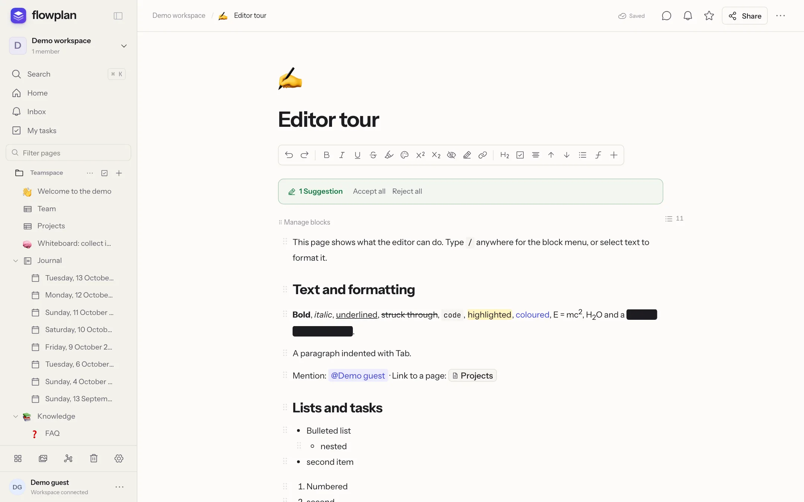
</picture>

</div>

## At a glance

- **Everything in one page tree** – documents, databases with ten views, whiteboards, a daily journal, projects with tickets and sprints, surveys.
- **Completely open source** under the AGPL-3.0 – no closed enterprise edition, no features behind a licence key.
- **One container with SQLite** – no Postgres, no Redis, no external search service. Or hosted in Germany at [app.flowplan.org](https://app.flowplan.org).
- **Optional AI** – off by default; admins switch it on per feature and per person, completely local with [Ollama](https://ollama.com) or with a key for OpenAI, Anthropic, Gemini or any OpenAI-compatible service. You decide which pages it may read.
- **Private by design** – no tracking, permissions down to a single record, two-factor sign-in, encryption of files and backups with your own key.
- **Your data stays portable** – Markdown with frontmatter, CSV and ZIP, scheduled exports to S3 or Git, import from Notion, AppFlowy, Obsidian, Jira and Trello.

The interface is available in English, German and French – further languages can be added as JSON catalogues ([Languages and translations](https://docs.flowplan.org/languages)); the documentation is in English and German.

**Contents:** [Write](#write-and-think) · [Databases](#organise-with-databases) · [AI](#ai-optional) · [Whiteboards and journal](#whiteboards-and-a-journal) · [Together](#together-everywhere) · [Admins and integrations](#for-admins-and-integrations) · [Quick start](#quick-start-docker) · [Development](#development) · [Community](#community)

## Write and think

A block editor that stays out of the way. Type `/` for the block menu or use Markdown shortcuts; long pages keep their table of contents beside the text.

<p align="center">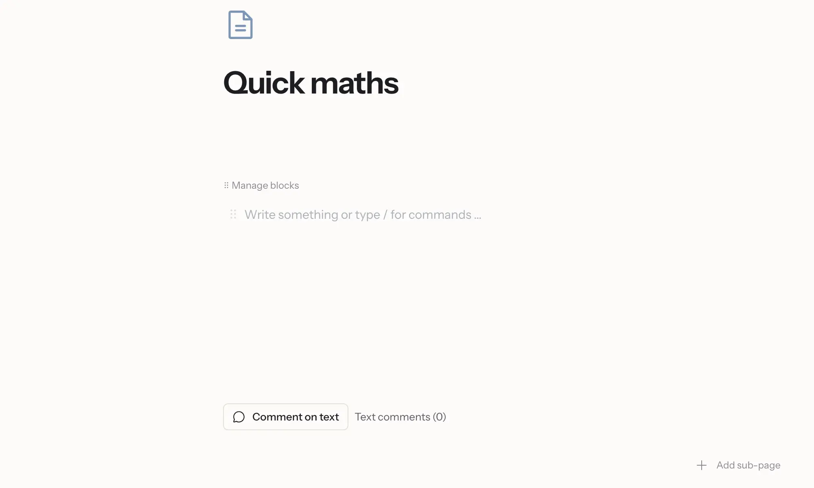</p>

**Calculate right in your notes** – type a calculation and `=`, press <kbd>Tab</kbd> for the result; expand, factor or solve a term, draw function graphs and vectors in 2D and 3D.

<details>
<summary><b>Everything in the editor</b></summary>

- Headings, lists, tasks with assignee and due date, tables, code with highlighting, Mermaid diagrams, KaTeX formulas
- Callouts like GitHub alerts, toggles, up to three columns, embeds and link cards, synced blocks
- **Footnotes**, **citations with a bibliography** (DOI, BibTeX, Zotero), Pandoc-style in the Markdown export
- **Edit a page as Markdown** and apply it back in one step
- **Show authors** – who wrote what, in colour
- Right-to-left text for Arabic, Hebrew and Persian
- Voice notes with transcription, photo annotation, focus mode with a word goal
- Version history with comparisons and single-paragraph restore, print and PDF layout
- Answers pasted from ChatGPT keep their formulas, lists and tables

</details>

## Organise with databases

Table, board, calendar, timeline, gallery, list, feed, chart, form and sprint views on the same records – with relations, rollups and formulas.

<p align="center">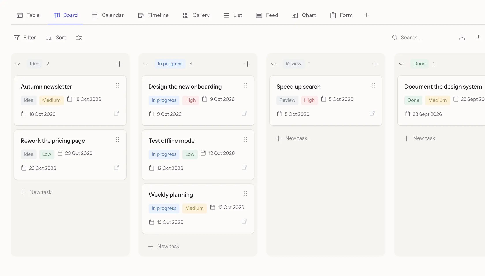</p>

<table>
  <tr>
    <td width="50%">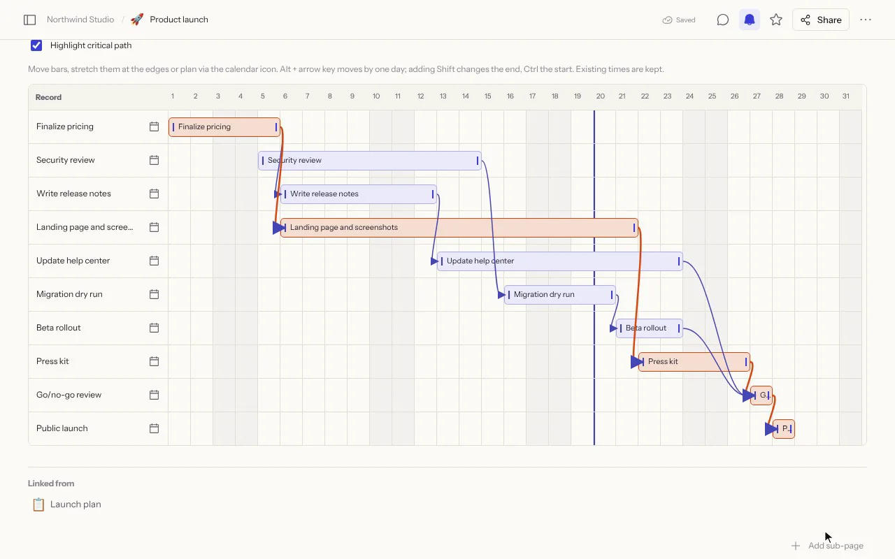</td>
    <td width="50%">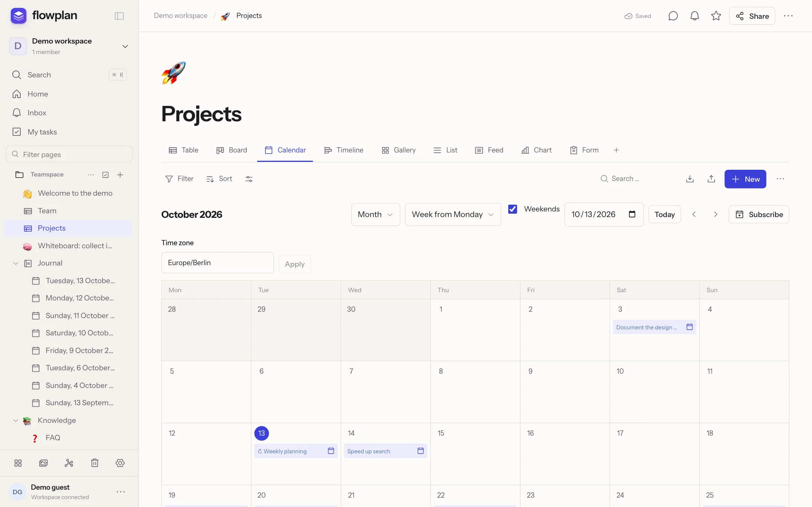</td>
  </tr>
  <tr>
    <td><b>Timeline</b> – Gantt with dependencies, the critical path and successors that move along.</td>
    <td><b>Calendar</b> – subscribe from Apple, Google or Outlook, or sync both ways via CalDAV.</td>
  </tr>
</table>

<details>
<summary><b>Everything in databases</b></summary>

- 23 property types including formula, relation, rollup and **AI property**
- Filter groups, sorting, grouping in three levels, swimlanes, calculations per column
- Recurring dates and reminders, record templates, record pages with their own layout, permissions per record
- **Projects and tickets** (optional, per database): ticket numbers like `WEB-123` linked in text, subtasks and epics, sprints with backlog, burndown and velocity, automations, status workflows, WIP limits, time tracking, Git connection for GitHub, GitLab and Gitea, dashboards
- **Surveys** with 19 question types, conditions and results – every answer is a record
- Import from CSV, Jira and Trello; Markdown with YAML frontmatter in both directions (Obsidian-friendly)

</details>

## AI, optional

AI in Flowplan is **off until an admin switches it on** – and then only for the features and people they choose. It runs **completely locally with Ollama**, so no text leaves your server, or with a key for OpenAI, Anthropic, Gemini or any OpenAI-compatible service. Admins can also let everyone bring their own key instead.

<p align="center">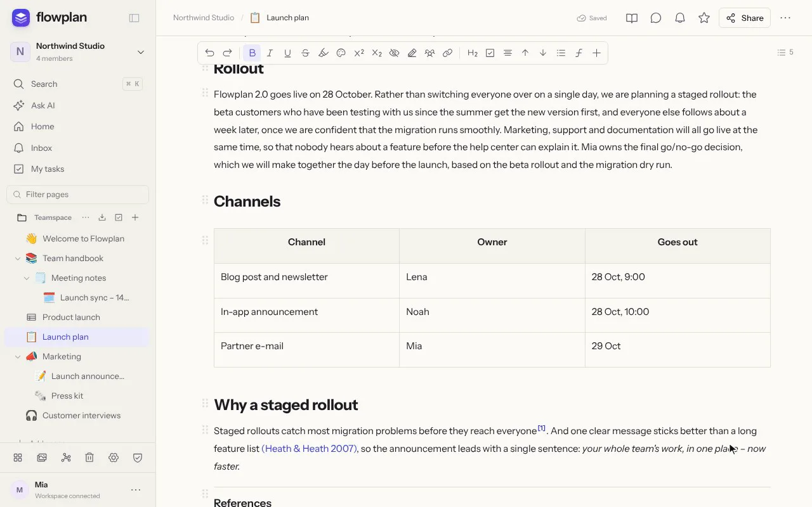</p>

<table>
  <tr>
    <td width="50%">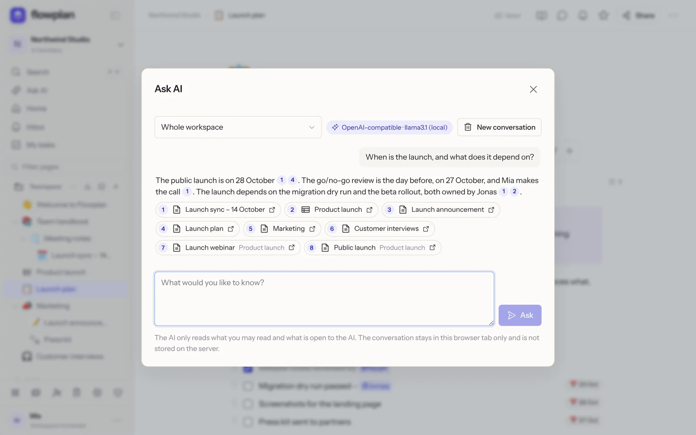</td>
    <td width="50%">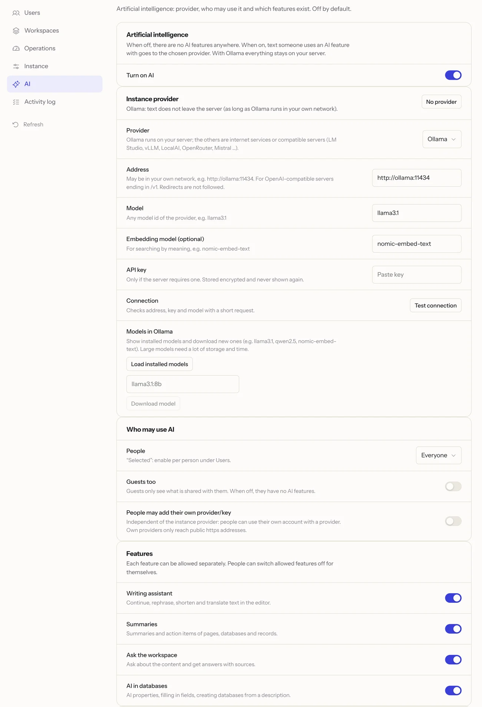</td>
  </tr>
  <tr>
    <td><b>Ask your workspace</b> – answers with links to their sources, never more than you may read.</td>
    <td><b>Under your control</b> – provider, people and every feature switched on separately.</td>
  </tr>
</table>

- **Writing assistant** – improve, rephrase, shorten, expand, translate, change the tone, or write from a prompt (<kbd>⌘</kbd> <kbd>J</kbd>, `/ai`).
- **Summaries** of pages, database views, records and voice notes – with key points and open tasks.
- **Ask your workspace** – full-text and, optionally, semantic search with embeddings.
- **AI in databases** – AI properties that fill themselves, fill in fields, create a database from a description.
- **You decide what it reads** – exclude workspaces, spaces or pages for yourself; managers can close pages to AI for everyone. PIN-locked journals and private records are never read.
- **Keys stay secret** – stored encrypted, never shown again, bound to the provider address.

See [AI in the documentation](https://docs.flowplan.org/ai).

## Whiteboards and a journal

<table>
  <tr>
    <td width="50%">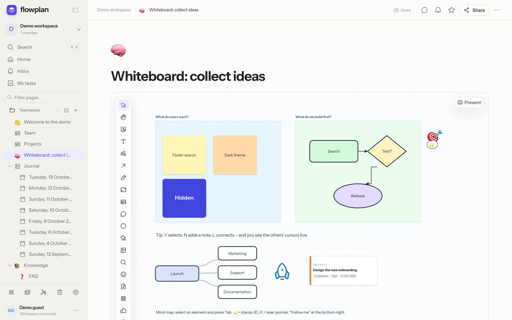</td>
    <td width="50%">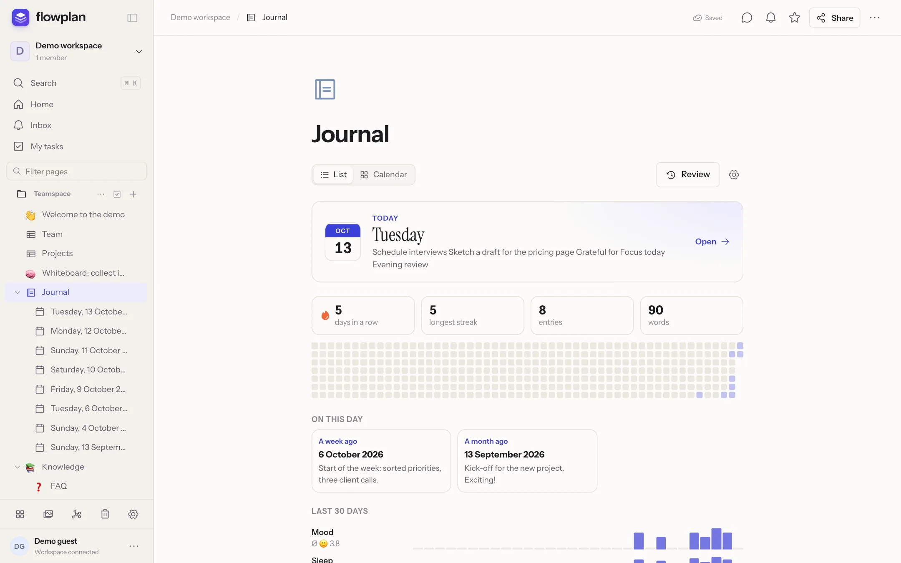</td>
  </tr>
  <tr>
    <td><b>Whiteboards</b> – sticky notes, shapes, connectors, frames, mind maps, voting, timer, presentation mode, import from Excalidraw and draw.io.</td>
    <td><b>Journal</b> – one page per day with templates, trackers, review, memories and an optional PIN lock.</td>
  </tr>
</table>

## Together, everywhere

Live editing with cursors (Yjs/CRDT), comments and inline threads, mentions, reactions, suggested changes, an inbox, e-mail digests and Web Push. Share a page with one person, with guests through links (optionally with **password and expiry date**), publish it on the web, or turn it into a form. Flowplan installs as an app and works offline; desktop apps for macOS, Windows and Linux are at [flowplan.org/download](https://flowplan.org/download).

<p align="center">
  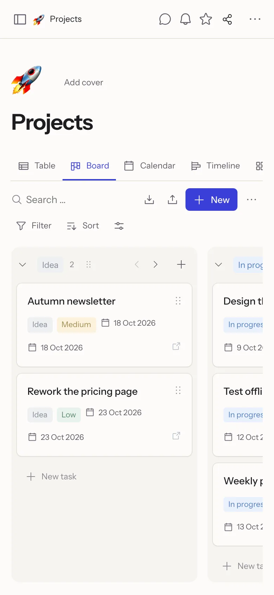
  &nbsp;
  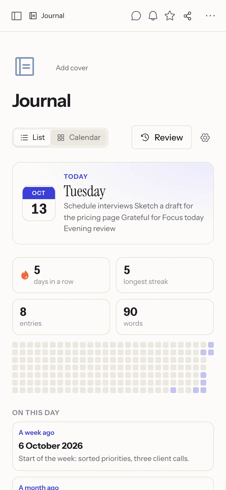
</p>

## For admins and integrations

<details open>
<summary><b>Sign-in and security</b></summary>

- E-mail and password, passkeys (WebAuthn), **two-factor sign-in with an authenticator app** (enforceable for everyone or admins only)
- Single sign-on with OpenID Connect; **SSO groups control roles and groups** in workspaces
- Permissions per space, page and record; guests; audit log; session management
- Encryption of files, backups and exports with your own key; secrets such as AI keys stored encrypted

</details>

<details>
<summary><b>Operations</b></summary>

- Limits per workspace and per person (storage, own workspaces, upload size)
- Continuous backup to S3 with Litestream, scheduled backups and Markdown exports to S3 or Git
- Full-text search including OCR for scanned PDFs and Office files
- Prometheus metrics, health endpoint, the running version and commit at a glance
- Docker image for `amd64` and `arm64`, a **Helm chart** for Kubernetes

</details>

<details>
<summary><b>Integrations</b></summary>

- REST API with read or write tokens, signed webhooks
- **n8n community node** (`n8n-nodes-flowplan`)
- [MCP server](https://docs.flowplan.org/mcp) for Claude, ChatGPT and other assistants – with the person's own permissions only
- Calendar subscriptions and two-way CalDAV, Git connection, web clipper
- Import from Notion, AppFlowy, Obsidian, Markdown, HTML, CSV, Jira and Trello ([moving guide](https://docs.flowplan.org/migrate))

</details>

## Quick start (Docker)

You need Docker and a domain with HTTPS in front (Caddy, Traefik, nginx, Coolify …).

```sh
curl -O https://raw.githubusercontent.com/yannicschuller/flowplan/main/compose.yaml
curl -o .env https://raw.githubusercontent.com/yannicschuller/flowplan/main/.env.example
# edit .env: at least APP_URL (optionally OIDC_* and SMTP_*)
docker compose up -d
```

Open your domain: a new instance offers **Create account** – the first account administers the instance.

- **Local AI (optional):** `docker compose --profile ai up -d` starts Ollama next to Flowplan; set `OLLAMA_URL=http://ollama:11434` and choose a model under **Administration → AI** ([AI](https://docs.flowplan.org/ai)).
- **Kubernetes:** the Helm chart in [`deploy/helm/flowplan`](deploy/helm/flowplan/README.md) (one pod with a volume, as SQLite needs).
- **Single sign-on:** register a confidential web client at your OIDC provider with the redirect URI `https://<your-domain>/api/auth/callback` ([Sign-in](https://docs.flowplan.org/sign-in)).

All data lives in the volume on `/app/data`. Run **exactly one** container per data directory (SQLite).

<details>
<summary><b>Images and automatic deployment</b></summary>

The image is published to the GitHub Container Registry for `linux/amd64` and `linux/arm64`:

```
ghcr.io/yannicschuller/flowplan:latest     # the latest release
ghcr.io/yannicschuller/flowplan:1.2.3      # a fixed release (also :1.2 and :1)
ghcr.io/yannicschuller/flowplan:beta       # the latest manual build, not for production
```

Images are built only for a release or by hand: **Actions → Docker image → Run workflow** builds `:beta` from the chosen branch (with a version, it rebuilds that release instead). Every `:beta` image can be rolled out on Coolify automatically: set the repository secrets `COOLIFY_WEBHOOK` (the resource's deploy webhook) and `COOLIFY_TOKEN` (an API token with deploy permission), and let the Coolify resource use the `:beta` image. See [Coolify and reverse proxies](https://docs.flowplan.org/coolify-and-proxy).

</details>

More in the documentation: [Installation](https://docs.flowplan.org/installation) · [Configuration](https://docs.flowplan.org/configuration) · [Storage, S3 and backups](https://docs.flowplan.org/storage-and-backups) · [Operations](https://docs.flowplan.org/operations)

## Development

Node.js 22.13 or newer (the Docker image and CI use Node 26).

```sh
npm ci
cp .env.example .env.local
npm run dev        # http://127.0.0.1:3000
```

Development mode also offers **Open local workspace**, a shared local example account. Production mode has no such access.

| Command | What it does |
| --- | --- |
| `npm run dev` | Development server |
| `npm run build` / `npm start` | Production build and server |
| `npm run typecheck` | TypeScript |
| `npm test` | Core tests (Node test runner, temporary data directories that are removed afterwards) |
| `npm run test:e2e` | Browser tests (Playwright, desktop and mobile); start a server with its own `FLOWPLAN_DATA_DIR` and set `TEST_BASE_URL` |
| `npm run check:standalone` | Runs the standalone build like the container and checks health, persistence and restore |

Stack: Next.js 16 (App Router), React 19, TypeScript, SQLite (`node:sqlite`), TipTap/ProseMirror with Yjs, Zod and Playwright. The documentation lives in [flowplan-docs](https://github.com/yannicschuller/flowplan-docs) (docs.flowplan.org), the website in [flowplan-website](https://github.com/yannicschuller/flowplan-website) (flowplan.org), the desktop apps in [flowplan-desktop](https://github.com/yannicschuller/flowplan-desktop); this repository contains the app, the Helm chart (`deploy/helm`) and the n8n node (`integrations/n8n`).

## Community

Questions, ideas, show-and-tell or just a hello: join the **[Flowplan Discord](https://discord.gg/bCEdB6MPrR)**. Bugs and feature requests are best filed as [GitHub issues](https://github.com/yannicschuller/flowplan/issues), so nothing gets lost.

## Contributing, security and licence

Contributions are welcome – see [CONTRIBUTING.md](CONTRIBUTING.md). Please report security issues privately as described in [SECURITY.md](SECURITY.md).

Flowplan is free software under the [GNU Affero General Public License v3.0](LICENSE). If you run a modified version as a network service, you must make its source code available to its users. The n8n node in `integrations/n8n` is MIT-licensed, as n8n requires for community nodes.
