<div align="center">

<h1>
  <a href="https://flowplan.org">
    <picture>
      <source media="(prefers-color-scheme: dark)" srcset=".github/assets/logo-dark.svg">
      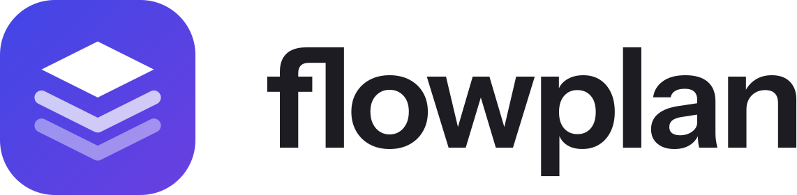
    </picture>
  </a>
</h1>

🇩🇪 [Deutsch](README.de.md) · 🇬🇧 **English**

**Open-source alternative to Notion and Confluence** – documents, databases, whiteboards and a daily journal for teams, self-hosted in one container or hosted in Germany.

### [Demo](https://flowplan.org/en/demo) · [Docs](https://docs.flowplan.org/en) · [Install](https://docs.flowplan.org/en/installation)

[](https://github.com/yannicschuller/flowplan/actions/workflows/ci.yml)
[](https://github.com/yannicschuller/flowplan/pkgs/container/flowplan)
[](https://github.com/yannicschuller/flowplan/releases)
[](https://github.com/yannicschuller/flowplan/stargazers)
[](https://docs.flowplan.org/en)
[](https://flowplan.org/en/demo)
[](LICENSE)
[](https://discord.gg/bCEdB6MPrR)
[](https://github.com/sponsors/yannicschuller)
[](https://www.opensourcealternatives.to)

<br>

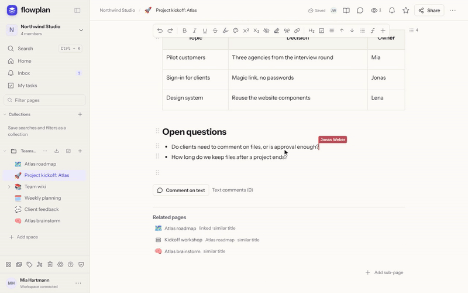

[Website](https://flowplan.org) · [Hosted version](https://app.flowplan.org) · [Discord](https://discord.gg/bCEdB6MPrR) · [Changelog](CHANGELOG.md)

</div>

## Contents

- [At a glance](#at-a-glance)
- [Quick start](#quick-start)
- [Features](#features) · [Screenshots](#screenshots) · [How Flowplan compares](#how-flowplan-compares) · [Private by design](#private-by-design)
- A closer look: [Write](#write-and-think) · [Databases](#organise-with-databases) · [AI](#ai-optional) · [Whiteboards and journal](#whiteboards-and-a-journal) · [Handwriting](#handwriting-and-notebooks) · [Home page](#a-home-page-of-your-own) · [Together](#together-everywhere)
- [For admins and integrations](#for-admins-and-integrations): [architecture](#architecture), [system requirements](#system-requirements), [security](#security)
- [FAQ](#faq)
- [Development](#development)
- [Community](#community): [help translate](#help-translate), [contributors](#contributors), [star history](#star-history)
- [Support Flowplan](#support-flowplan)

## At a glance

- **Everything in one page tree** – documents, databases with ten views, whiteboards, notebooks for handwriting, a daily journal, projects with tickets and sprints, surveys and workflows.
- **Completely open source** under the AGPL-3.0 – no closed enterprise edition, no features behind a licence key.
- **One container with SQLite** – nothing else to run, no external search service. For larger teams optionally [PostgreSQL](https://docs.flowplan.org/en/postgresql) and a [cluster](https://docs.flowplan.org/en/cluster) of several instances. Or hosted in Germany at [app.flowplan.org](https://app.flowplan.org).
- **Optional AI** – off by default; admins switch it on per feature and per person, completely local with [Ollama](https://ollama.com) or with a key for OpenAI, Anthropic, Gemini or any OpenAI-compatible service. You decide which pages it may read.
- **Private by design** – no tracking, permissions down to a single record, two-factor sign-in, encryption of files and backups with your own key.
- **Your data stays portable** – Markdown with frontmatter, CSV and ZIP, scheduled exports to S3 or Git, import from Notion, AppFlowy, Obsidian, Jira and Trello.

The interface is available in German, English, French and Simplified Chinese – further languages can be added as JSON catalogues ([help translate](#help-translate)); the documentation is in English and German.

## Quick start

Try Flowplan on your own computer with a single command:

```sh
docker run -d --name flowplan -p 3000:3000 -v flowplan:/app/data -e APP_URL=http://localhost:3000 ghcr.io/yannicschuller/flowplan:latest
```

Open <http://localhost:3000> and choose **Create account** – the first account administers the instance. `APP_URL` must be the address exactly as you type it in the browser: to reach Flowplan from another device or under a domain, change it (for example `-e APP_URL=https://flowplan.example.com`) and put a reverse proxy with HTTPS in front. All data lives in the `flowplan` volume.

<details>
<summary><b>Docker Compose for a server</b> – volume, <code>APP_URL</code> and optional S3</summary>

```yaml
services:
  flowplan:
    image: ghcr.io/yannicschuller/flowplan:latest
    restart: unless-stopped
    ports:
      - "127.0.0.1:3000:3000"   # a reverse proxy with HTTPS sits in front
    environment:
      APP_URL: https://flowplan.example.com
      # Recommended: the first account only via https://flowplan.example.com/register?setup=<token>
      # (openssl rand -hex 24), so nobody sets the instance up before you
      # FLOWPLAN_SETUP_TOKEN: ...
      # Optional: mirror files to S3 and back up the database continuously (Litestream)
      # S3_BUCKET: flowplan
      # S3_ENDPOINT: https://s3.example.com
      # S3_REGION: eu-central-1
      # S3_ACCESS_KEY_ID: ...
      # S3_SECRET_ACCESS_KEY: ...
      # Encrypts files in the bucket, backups and exports: openssl rand -base64 32
      # FLOWPLAN_ENCRYPTION_KEY: ...
    volumes:
      - flowplan-data:/app/data

volumes:
  flowplan-data:
```

`docker compose up -d`, then open your domain. Single sign-on, e-mail and every other setting are environment variables too – see [Configuration](https://docs.flowplan.org/en/configuration).

</details>

The repository also has a ready-made [`compose.yaml`](compose.yaml) with an example configuration:

```sh
curl -O https://raw.githubusercontent.com/yannicschuller/flowplan/main/compose.yaml
curl -o .env https://raw.githubusercontent.com/yannicschuller/flowplan/main/.env.example
# edit .env: at least APP_URL (optionally OIDC_* and SMTP_*)
docker compose up -d
```

- **Local AI (optional):** `docker compose --profile ai up -d` starts Ollama next to Flowplan; set `OLLAMA_URL=http://ollama:11434` and choose a model under **Administration → AI** ([AI](https://docs.flowplan.org/en/ai)).
- **Kubernetes:** the Helm chart in [`deploy/helm/flowplan`](deploy/helm/flowplan/README.md) (one pod with a volume, as SQLite needs; several pods in [cluster mode](https://docs.flowplan.org/en/cluster#kubernetes-helm)).
- **Single sign-on:** register a confidential web client at your OIDC provider with the redirect URI `https://<your-domain>/api/auth/callback` ([Sign-in](https://docs.flowplan.org/en/sign-in)).

- **Larger teams:** instead of SQLite, Flowplan can use [PostgreSQL](https://docs.flowplan.org/en/postgresql) (with `pgvector` for semantic search) – and with PostgreSQL, Redis and S3, several instances behind a load balancer in [cluster mode](https://docs.flowplan.org/en/cluster). An existing instance [switches between SQLite and PostgreSQL](https://docs.flowplan.org/en/database-migration) in both directions; [Sizing](https://docs.flowplan.org/en/sizing) says which setup fits how many people.

All data lives in the volume on `/app/data`. With SQLite, run **exactly one** container per data directory.

<details>
<summary><b>Images and automatic deployment</b></summary>

The image is published to the GitHub Container Registry for `linux/amd64` and `linux/arm64`:

```
ghcr.io/yannicschuller/flowplan:latest     # the latest release
ghcr.io/yannicschuller/flowplan:1.2.3      # a fixed release (also :1.2 and :1)
ghcr.io/yannicschuller/flowplan:beta       # the latest manual build, not for production
```

Images are built only for a release or by hand: **Actions → Docker image → Run workflow** builds `:beta` from the chosen branch (with a version, it rebuilds that release instead). Every `:beta` image can be rolled out on Coolify automatically: set the repository secrets `COOLIFY_WEBHOOK` (the resource's deploy webhook) and `COOLIFY_TOKEN` (an API token with deploy permission), and let the Coolify resource use the `:beta` image. A release that is newer than the current `:beta` (its commit not yet contained in it) is tagged `:beta` as well and rolled out the same way; an older release leaves it alone. See [Coolify and reverse proxies](https://docs.flowplan.org/en/coolify-and-proxy).

</details>

More in the documentation: [Installation](https://docs.flowplan.org/en/installation) · [Configuration](https://docs.flowplan.org/en/configuration) · [Storage, S3 and backups](https://docs.flowplan.org/en/storage-and-backups) · [Operations](https://docs.flowplan.org/en/operations)

## Features

<table>
  <tr>
    <td width="33%" valign="top">📝 <b><a href="https://docs.flowplan.org/en/documents">Documents</a></b><br>A block editor with the <code>/</code> menu, Markdown shortcuts, formulas, Mermaid, footnotes and version history.</td>
    <td width="33%" valign="top">🗂️ <b><a href="https://docs.flowplan.org/en/databases">Databases and views</a></b><br>23 property types with relations and formulas – as table, board, calendar, timeline, gallery, chart and more.</td>
    <td width="33%" valign="top">🧩 <b><a href="https://docs.flowplan.org/en/whiteboards">Whiteboards</a></b><br>Sticky notes, connectors, mind maps and shape libraries – and server <a href="https://docs.flowplan.org/en/whiteboards#racks-and-cabling">racks with cabling</a>.</td>
  </tr>
  <tr>
    <td valign="top">📔 <b><a href="https://docs.flowplan.org/en/journal">Journal</a></b><br>One page per day with templates, trackers, monthly reviews and an optional PIN lock.</td>
    <td valign="top">🎯 <b><a href="https://docs.flowplan.org/en/projects-and-tickets">Projects and sprints</a></b><br>Tickets like <code>WEB-123</code>, epics, sprints with burndown, automations and a Git connection.</td>
    <td valign="top">📋 <b><a href="https://docs.flowplan.org/en/forms">Forms and surveys</a></b><br>Forms on any database and surveys with 19 question types – every answer is a record.</td>
  </tr>
  <tr>
    <td valign="top">🔎 <b><a href="https://docs.flowplan.org/en/search-and-notifications">Collections and search</a></b><br>Full-text search with OCR for PDFs and Office files; keep searches and filters as collections.</td>
    <td valign="top">✨ <b><a href="https://docs.flowplan.org/en/ai">AI, optional</a></b><br>Off until an admin turns it on – locally with Ollama or with your own OpenAI, Anthropic or Gemini key.</td>
    <td valign="top">🔄 <b><a href="https://docs.flowplan.org/en/migrate">Import and export</a></b><br>In from Notion, Confluence, AFFiNE, AppFlowy, Obsidian, Evernote and more; out as Markdown, CSV, PDF or Word.</td>
  </tr>
  <tr>
    <td valign="top">📱 <b><a href="https://docs.flowplan.org/en/offline-and-apps">Apps</a></b><br>An installable web app that works offline, desktop apps, and apps for iPhone, iPad and Android.</td>
    <td valign="top">🔐 <b><a href="https://docs.flowplan.org/en/sign-in">Security</a></b><br>SSO with OIDC, LDAP and SCIM, two-factor sign-in, passkeys and <a href="https://docs.flowplan.org/en/encrypted-spaces">end-to-end encrypted spaces</a>.</td>
    <td valign="top">💾 <b><a href="https://docs.flowplan.org/en/storage-and-backups">Self-hosting and backups</a></b><br>One container with SQLite or PostgreSQL and a cluster, continuous backup to S3 with Litestream, scheduled encrypted backups, a Helm chart.</td>
  </tr>
  <tr>
    <td colspan="3" valign="top">🔀 <b><a href="https://docs.flowplan.org/en/workflows">Workflows</a></b><br>Flows of nodes on a canvas, without code: a trigger – a record, page, form, schedule, mention, webhook or e-mail – then conditions, loops, waits and approvals, and actions on records and pages, notifications, AI and HTTP. Test runs, run history, versions, templates and an AI builder; a workflow never does more than the person who activated it.</td>
  </tr>
</table>

## Screenshots

<table>
  <tr>
    <td width="50%">
      <picture>
        <source media="(prefers-color-scheme: dark)" srcset=".github/assets/readme/screenshot-document-dark.png">
        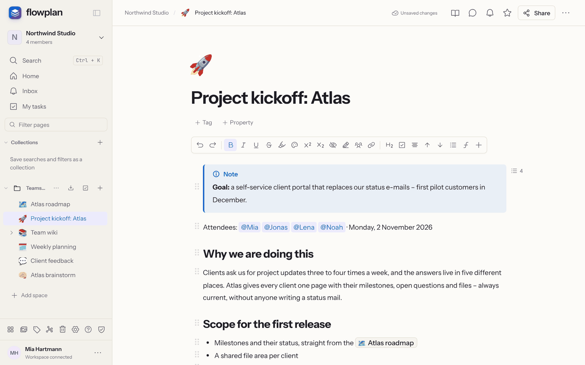
      </picture>
    </td>
    <td width="50%">
      <picture>
        <source media="(prefers-color-scheme: dark)" srcset=".github/assets/readme/screenshot-database-dark.png">
        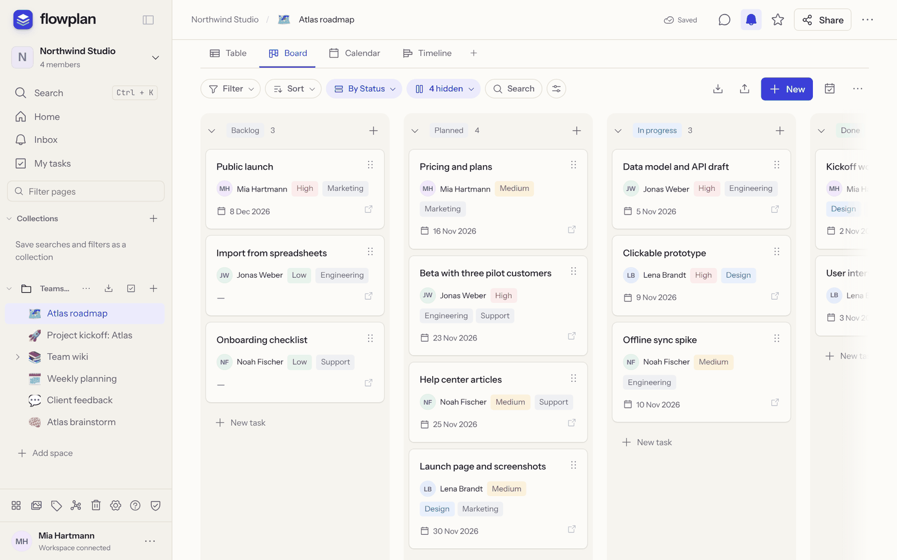
      </picture>
    </td>
  </tr>
  <tr>
    <td><b>Documents</b> – a project kickoff with a callout, mentions, a decision table and links to the roadmap.</td>
    <td><b>Databases</b> – the same roadmap as table, board, calendar and timeline.</td>
  </tr>
  <tr>
    <td>
      <picture>
        <source media="(prefers-color-scheme: dark)" srcset=".github/assets/readme/screenshot-whiteboard-dark.png">
        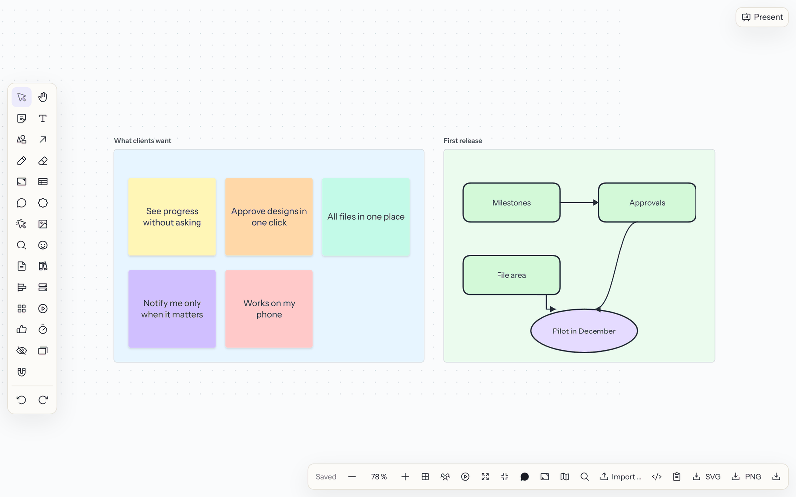
      </picture>
    </td>
    <td>
      <picture>
        <source media="(prefers-color-scheme: dark)" srcset=".github/assets/readme/screenshot-phone-dark.png">
        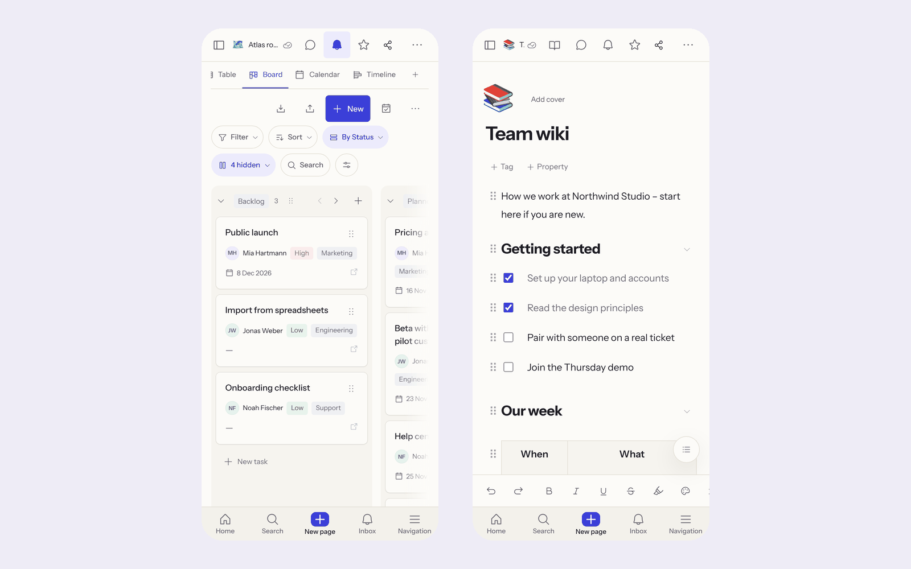
      </picture>
    </td>
  </tr>
  <tr>
    <td><b>Whiteboards</b> – sticky notes, frames and connectors, edited together live.</td>
    <td><b>On the phone</b> – the same workspace in the browser or the apps.</td>
  </tr>
</table>

<sub>GitHub shows the screenshots in light or dark, matching your theme.</sub>

## How Flowplan compares

A fair comparison is hard – every tool here is good at something. This is our best reading of each product's own documentation.

| | Flowplan | Notion | Confluence | AFFiNE | AppFlowy | Outline |
| --- | :---: | :---: | :---: | :---: | :---: | :---: |
| **Self-hostable** | ✅ | ❌ | ⚠️ Data Center only, being retired¹ | ✅ | ✅ | ✅ |
| **Open source** | ✅ | ❌ | ❌ | ✅ | ✅ | ⚠️ source-available |
| **Licence** | AGPL-3.0 | proprietary | proprietary | MIT (Community Edition)² | AGPL-3.0 | BSL 1.1 |
| **Works offline** | ✅³ | ⚠️ pages saved for offline | ❌ | ✅ local-first | ✅ local-first | ❌ |
| **Databases** | ✅ 10 views | ✅ | ⚠️ newer, Cloud only | ⚠️ database blocks | ✅ | ❌ |
| **Whiteboards** | ✅ | ❌ embeds only | ✅ Cloud | ✅ edgeless mode | ⚠️ not built in, as far as we know | ❌ |
| **Journal** | ✅ | ⚠️ templates | ⚠️ templates | ✅ | ⚠️ templates | ⚠️ templates |
| **End-to-end encryption** | ⚠️ encrypted spaces, documents only⁴ | ❌ | ❌ | ⚠️ local data only, as far as we know | ⚠️ status unclear | ❌ |
| **Import from others** | ✅ Notion, Confluence, AFFiNE, AppFlowy, Obsidian, Evernote, Google Docs, Microsoft Word, Jira, Trello | ✅ | ⚠️ a few formats | ✅ Notion, Markdown, HTML | ✅ Notion, Markdown, CSV | ✅ Notion, Confluence, Markdown |
| **Apps (iOS / Android / desktop)** | ⚠️ desktop and iOS; Android as APK | ✅ | ⚠️ mobile only | ⚠️ desktop; mobile apps newer | ✅ | ⚠️ desktop; mobile via the web |
| **Real-time collaboration** | ✅ | ✅ | ✅ | ✅ | ✅ with AppFlowy Cloud | ✅ |

<sub>✅ yes · ⚠️ partly · ❌ no. As of November 2026, corrections welcome – please [open an issue](https://github.com/yannicschuller/flowplan/issues/new/choose).<br>
¹ Atlassian sells no new Server licences and has announced the end of Data Center. ² Enterprise features under a separate licence. ³ Documents and records; encrypted pages and changes to a database's properties and views need a connection ([details](https://docs.flowplan.org/en/offline-and-apps#work-without-a-connection)). ⁴ Content and files are encrypted in the browser; page structure and member lists are not ([details](https://docs.flowplan.org/en/encrypted-spaces)).</sub>

## Private by design

- **No tracking** – no analytics or advertising cookies, no profiles. The statistics in the administration are counts only (no IP addresses, paths or names) and stay on your instance ([Operations](https://docs.flowplan.org/en/operations#statistics)).
- **Hosted in Germany** – the hosted version at [app.flowplan.org](https://app.flowplan.org) runs on servers in Germany. Or run it on your own server: it sends no usage data anywhere, and its check for new releases on GitHub can be turned off with `FLOWPLAN_UPDATE_CHECK=false`.
- **Everything exportable** – Markdown with YAML frontmatter, ZIP with all files, CSV, HTML/JSON, Word, PDF and EPUB; scheduled exports to S3 or Git ([Import, export and versions](https://docs.flowplan.org/en/import-export-versions)).
- **Open source under the AGPL-3.0** – all of it: no closed enterprise edition, no features behind a licence key.

## Write and think

A block editor that stays out of the way. Type `/` for the block menu or use Markdown shortcuts; long pages keep their table of contents beside the text.

<p align="center">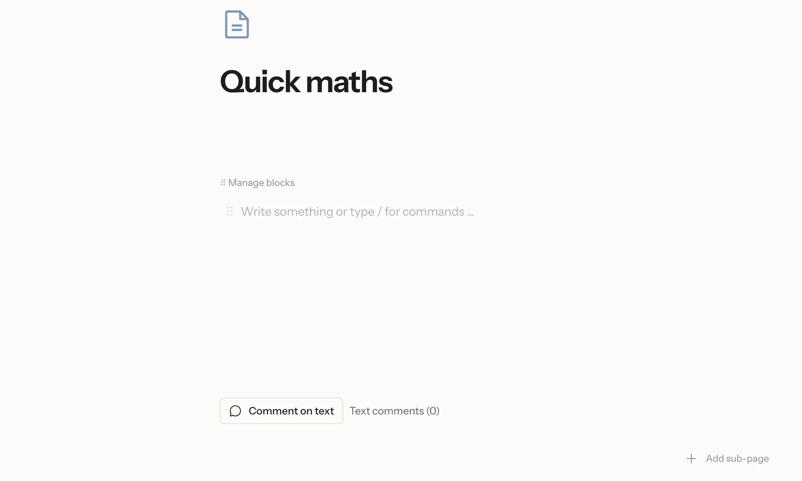</p>

**Calculate right in your notes** – type a calculation and `=`, press <kbd>Tab</kbd> for the result; expand, factor or solve a term, draw function graphs and vectors in 2D and 3D.

<details>
<summary><b>Everything in the editor</b></summary>

- Headings, lists, tasks with assignee and due date, tables, code with highlighting, Mermaid diagrams, KaTeX formulas
- Callouts like GitHub alerts, toggles, up to three columns, embeds and link cards, synced blocks
- **Footnotes**, **citations with a bibliography** (DOI, BibTeX, Zotero), Pandoc-style in the Markdown export
- **Edit a page as Markdown** and apply it back in one step
- **Show authors** – who wrote what, in colour
- Right-to-left text for Arabic, Hebrew and Persian
- Voice notes with transcription, photo annotation, focus mode with a word goal
- Version history with comparisons and single-paragraph restore, print and PDF layout
- Answers pasted from ChatGPT keep their formulas, lists and tables

</details>

## Organise with databases

Table, board, calendar, timeline, gallery, list, feed, chart, form and sprint views on the same records – with relations, rollups and formulas.

<p align="center">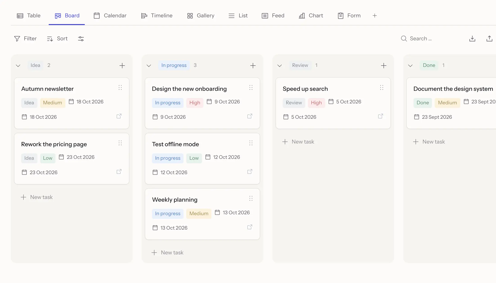</p>

<table>
  <tr>
    <td width="50%">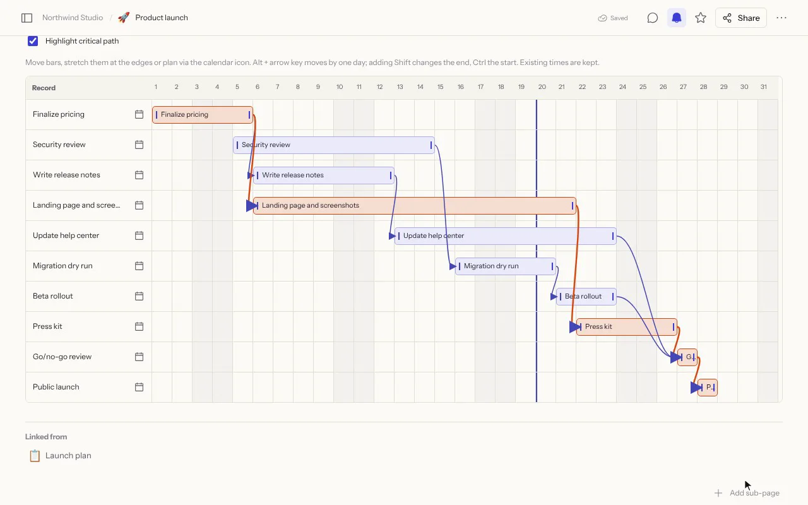</td>
    <td width="50%">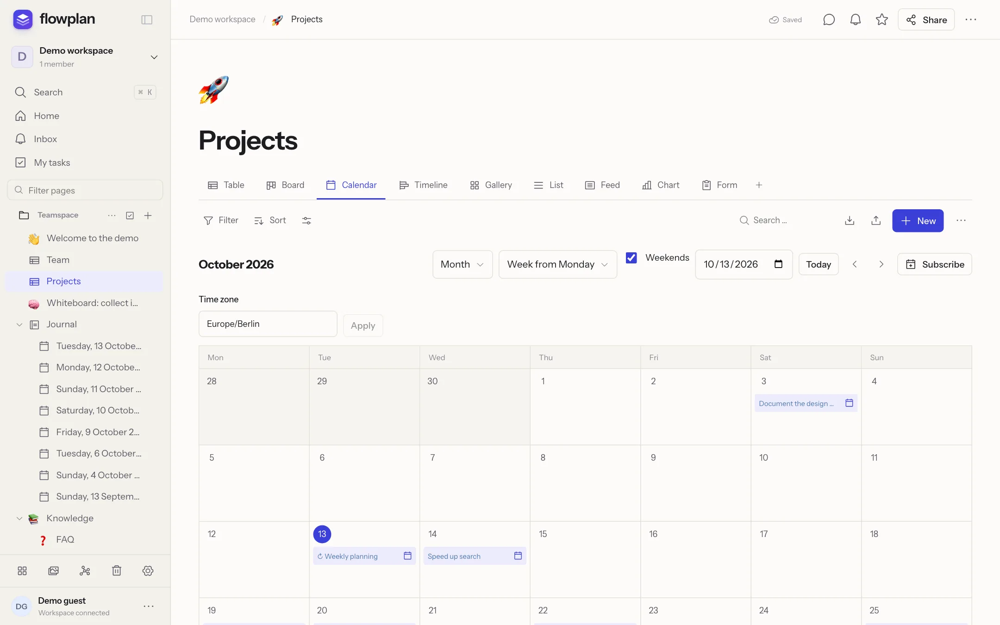</td>
  </tr>
  <tr>
    <td><b>Timeline</b> – Gantt with dependencies, the critical path and successors that move along.</td>
    <td><b>Calendar</b> – subscribe from Apple, Google or Outlook, or sync both ways via CalDAV.</td>
  </tr>
</table>

<details>
<summary><b>Everything in databases</b></summary>

- 23 property types including formula, relation, rollup and **AI property**
- Filter groups, sorting, grouping in three levels, swimlanes, calculations per column
- Recurring dates and reminders, record templates, record pages with their own layout, permissions per record
- **Projects and tickets** (optional, per database): ticket numbers like `WEB-123` linked in text, subtasks and epics, sprints with backlog, burndown and velocity, automations, status workflows, WIP limits, time tracking, Git connection for GitHub, GitLab and Gitea, dashboards
- **Surveys** with 19 question types, conditions and results – every answer is a record
- Import from CSV, Jira and Trello; Markdown with YAML frontmatter in both directions (Obsidian-friendly)

</details>

## AI, optional

AI in Flowplan is **off until an admin switches it on** – and then only for the features and people they choose. It runs **completely locally with Ollama**, so no text leaves your server, or with a key for OpenAI, Anthropic, Gemini or any OpenAI-compatible service. Admins can also let everyone bring their own key instead.

<p align="center">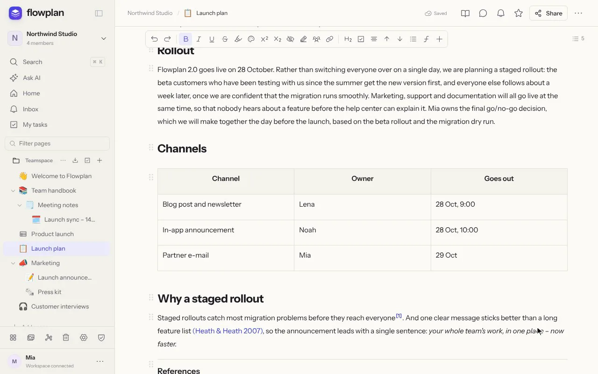</p>

<table>
  <tr>
    <td width="50%">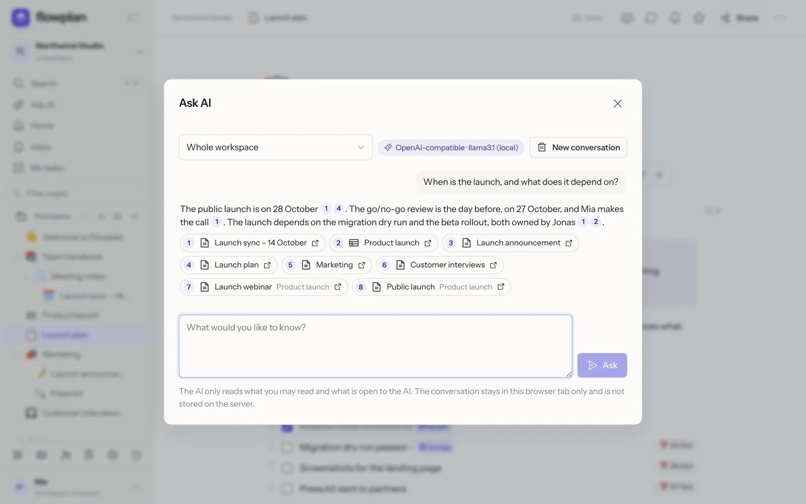</td>
    <td width="50%">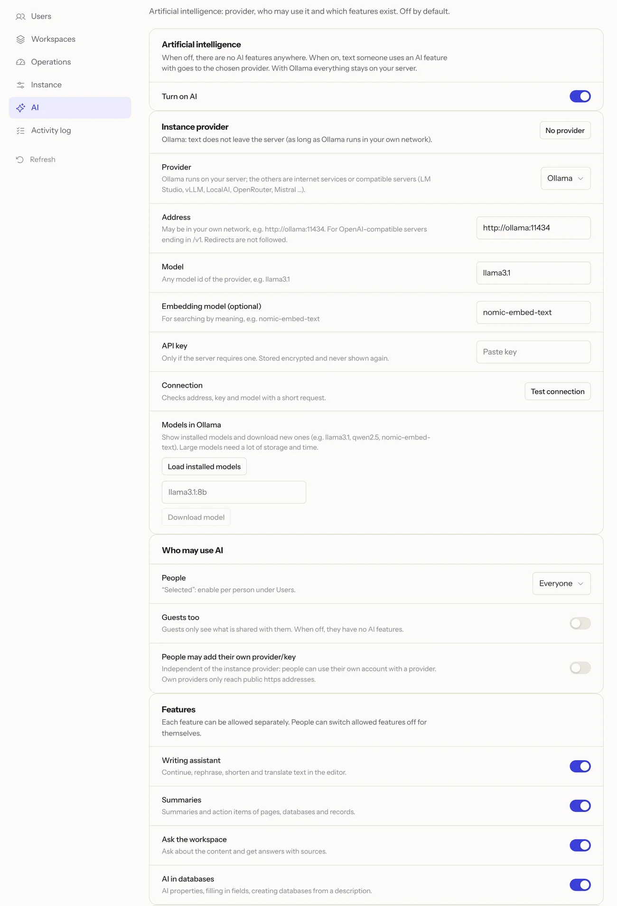</td>
  </tr>
  <tr>
    <td><b>Ask your workspace</b> – answers with links to their sources, never more than you may read.</td>
    <td><b>Under your control</b> – provider, people and every feature switched on separately.</td>
  </tr>
</table>

- **Writing assistant** – improve, rephrase, shorten, expand, translate, change the tone, or write from a prompt (<kbd>⌘</kbd> <kbd>J</kbd>, `/ai`).
- **Summaries** of pages, database views, records and voice notes – with key points and open tasks.
- **Ask your workspace** – full-text and, optionally, semantic search with embeddings.
- **AI in databases** – AI properties that fill themselves, fill in fields, create a database from a description.
- **You decide what it reads** – exclude workspaces, spaces or pages for yourself; managers can close pages to AI for everyone. PIN-locked journals and private records are never read.
- **Keys stay secret** – stored encrypted, never shown again, bound to the provider address.

See [AI in the documentation](https://docs.flowplan.org/en/ai).

## Whiteboards and a journal

<table>
  <tr>
    <td width="50%">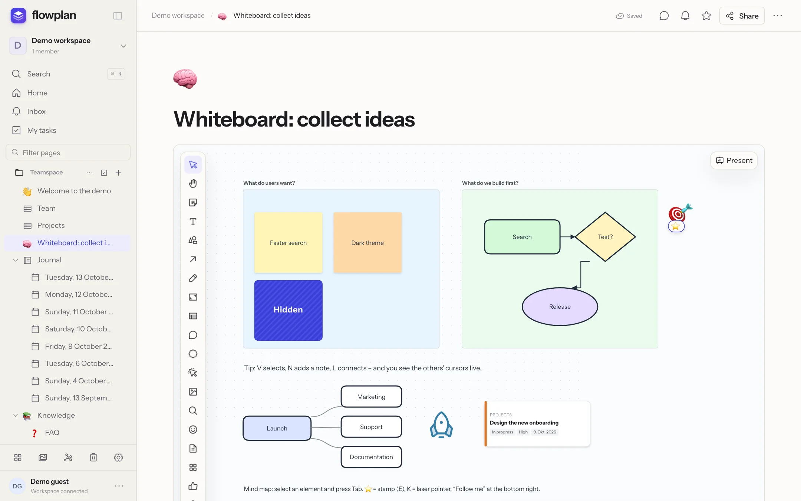</td>
    <td width="50%">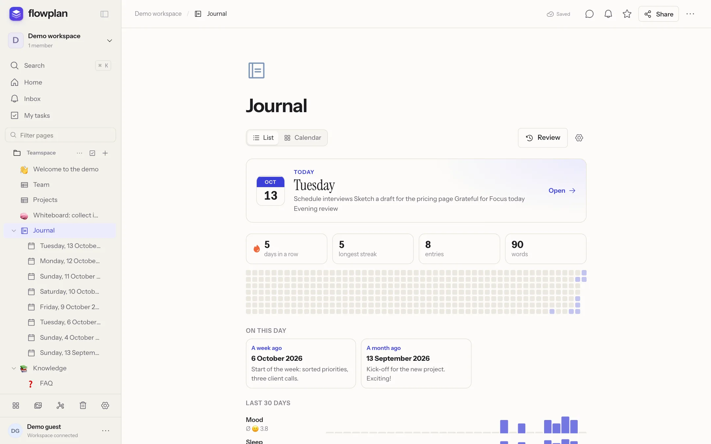</td>
  </tr>
  <tr>
    <td><b>Whiteboards</b> – sticky notes, shapes, connectors, frames, mind maps, voting, timer, presentation mode, import from Excalidraw and draw.io.</td>
    <td><b>Journal</b> – one page per day with templates, trackers, review, memories and an optional PIN lock.</td>
  </tr>
</table>

## Handwriting and notebooks

Write with the Apple Pencil, another tablet pen, a mouse or a finger – in notebooks, on PDFs and in the middle of a document.

<p align="center">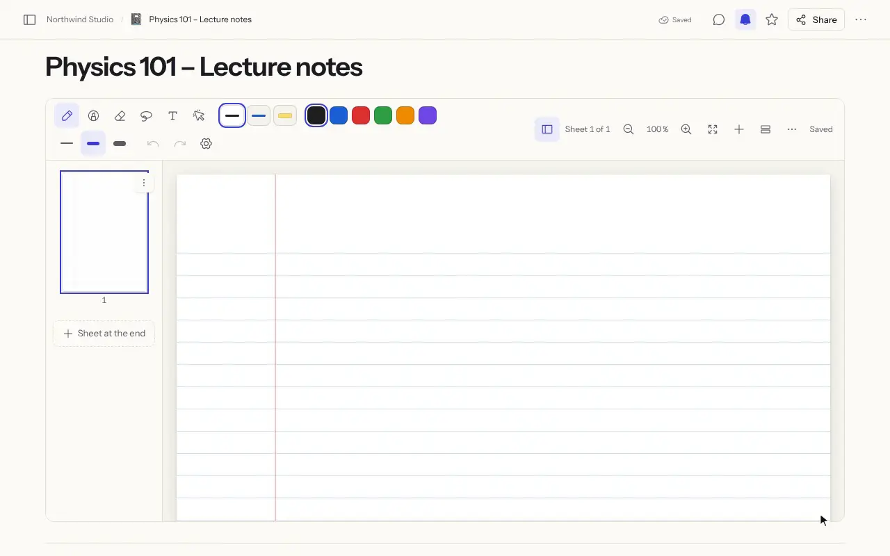</p>

**Notebooks** are a page kind of their own: sheets of blank, lined, grid, dotted, Cornell or music paper, A4 or Letter, light or dark, with previews to jump to and reorder them. A PDF opens as a notebook to write on page by page, and every notebook exports as a PDF with the handwriting as vectors.

<picture>
  <source media="(prefers-color-scheme: dark)" srcset=".github/assets/readme/notebook-ipad-dark.webp">
  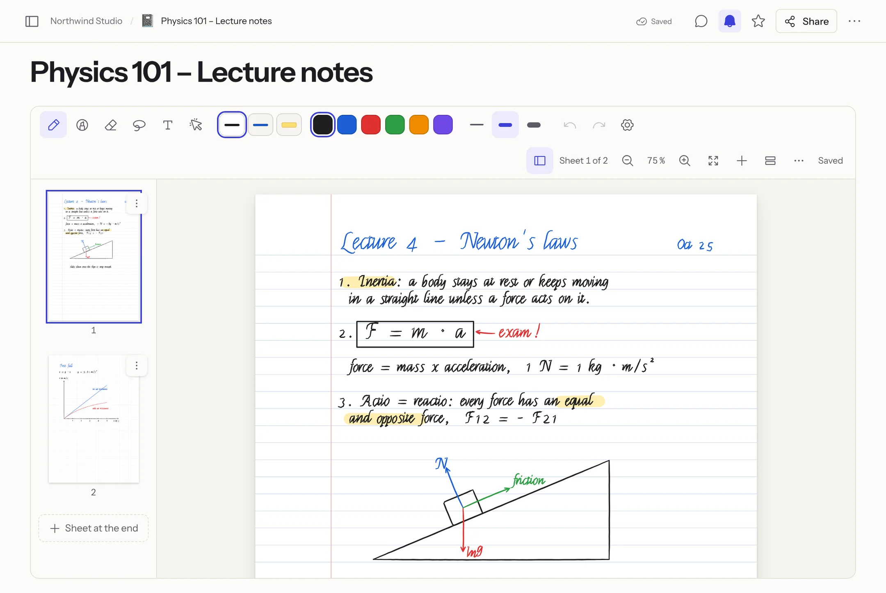
</picture>

<table>
  <tr>
    <td width="50%">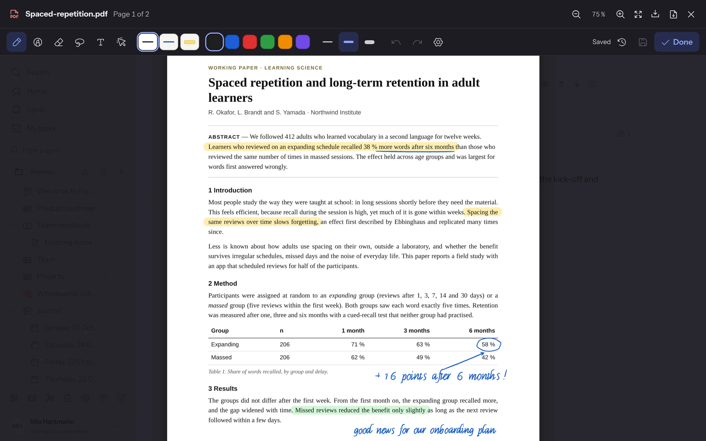</td>
    <td width="50%">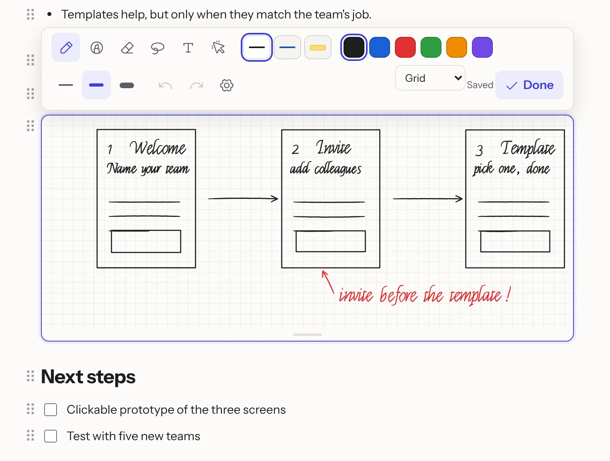</td>
  </tr>
  <tr>
    <td><b>Write on PDFs</b> – highlighter and pen right in the viewer; every save is a version, and the PDF downloads with the annotations.</td>
    <td><b>Drawing blocks</b> – <code>/draw</code> puts a sketch between the paragraphs of a document; strokes drawn at the same time are merged, not overwritten.</td>
  </tr>
</table>

- Pen with pressure, highlighter, erasers for whole strokes or parts, lasso to move, resize and recolour, text and a laser pointer; three favourite pens
- Hold the pen still at the end of a stroke and it snaps into a straight line, rectangle, ellipse, triangle or diamond
- Once you write with a pen, only the pen draws: fingers scroll and zoom, a resting hand leaves no marks
- In the iPhone and iPad app, handwriting is recognised on the device: search finds it, and **Convert to text** turns selected strokes into typed text

See [Notebooks and handwriting](https://docs.flowplan.org/en/notebooks).

## A home page of your own

<p align="center">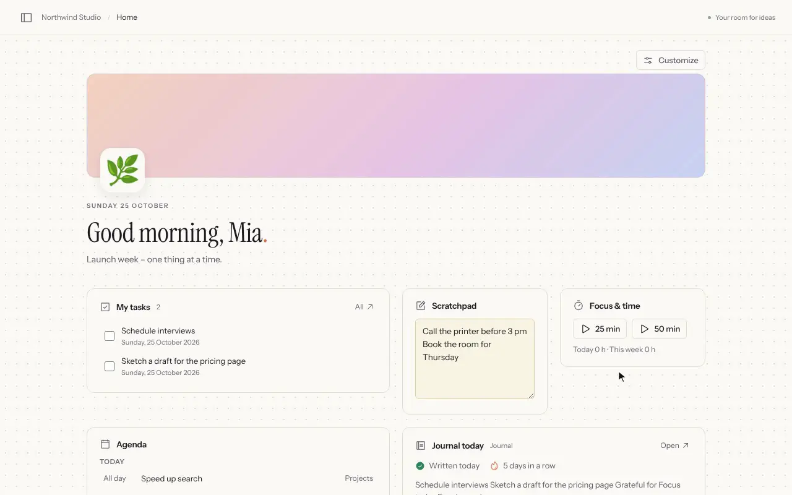</p>

Arrange the home page from 20 widgets – tasks to tick off, agenda, journal today, focus timer, habits, counters, a scratchpad, a database view, links and more. Drag, resize and set them up per workspace, give the page a header colour, gradient or cover, an emoji, spacing and a background; workspace owners set the default for their members. See [Customize your home page](https://docs.flowplan.org/en/first-steps#customize-your-home-page).

## Together, everywhere

Live editing with cursors (Yjs/CRDT), comments and inline threads, mentions, reactions, suggested changes, an inbox, e-mail digests and Web Push. Share a page with one person, with guests through links (optionally with **password and expiry date**), publish it on the web, or turn it into a form. Flowplan installs as an app and works offline; desktop apps for macOS, Windows and Linux are at [flowplan.org/download](https://flowplan.org/download) – with quick capture from any app (shorthand like `morgen 15 Uhr #kunde @anna !hoch`, links, files, screen regions and voice notes, an offline queue; [docs](https://docs.flowplan.org/en/desktop-capture)). For **iPhone and iPad the app is on the [App Store](https://apps.apple.com/app/id6825801344)**, for **Android an app to [download](https://flowplan.org/download/android.apk)** without the Play Store (it updates itself) – with widgets, notification buttons, Siri and Shortcuts, sharing from other apps, the Apple Pencil and windows on the iPad ([Apps](https://docs.flowplan.org/en/offline-and-apps#apps-for-iphone-ipad-and-android)). Their notifications travel through the open-source [Flowplan push relay](https://github.com/yannicschuller/flowplan-push), end-to-end encrypted: they show their text, while the relay, Apple and Google only handle ciphertext.

<p align="center">
  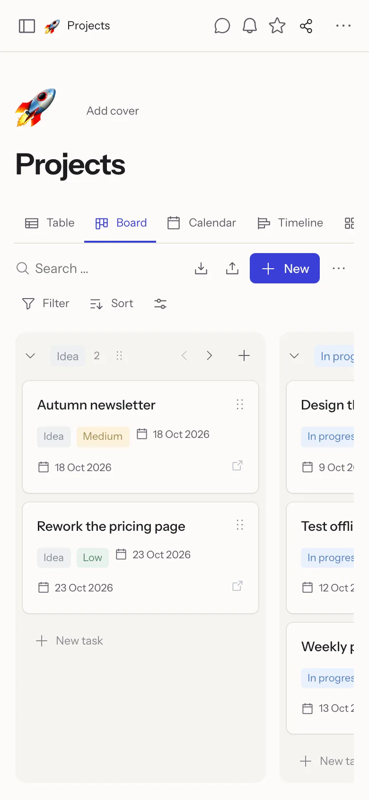
  &nbsp;
  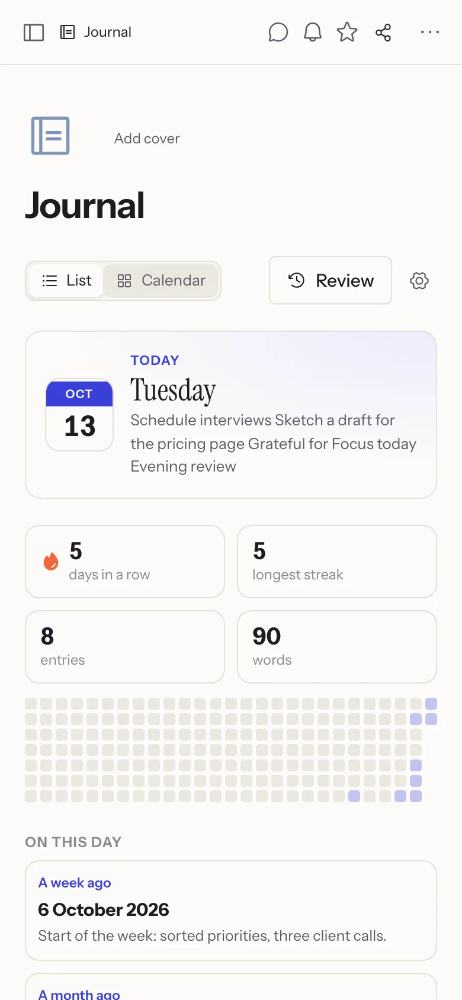
</p>

## For admins and integrations

### Architecture

<picture>
  <source media="(prefers-color-scheme: dark)" srcset=".github/assets/readme/architecture-en-dark.png">
  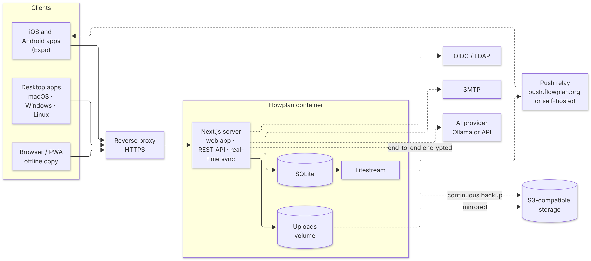
</picture>

Dashed lines are optional. Everything Flowplan stores lives in one data directory (`/app/data`): the SQLite database, uploads and keys. With [PostgreSQL](https://docs.flowplan.org/en/postgresql) the database moves there; in [cluster mode](https://docs.flowplan.org/en/cluster) several instances share PostgreSQL, Redis and S3. The [push relay](https://github.com/yannicschuller/flowplan-push) only carries notifications to the mobile apps; it sees ciphertext.

### System requirements

| | |
| --- | --- |
| **Memory and CPU** | The Helm chart's defaults are a good guide for a small team: 256 MB of RAM requested, up to 1 GB, a fraction of one CPU. Text recognition for scanned PDFs and large imports briefly need more CPU. |
| **Platforms** | Docker images for `linux/amd64` and `linux/arm64`; Kubernetes with the [Helm chart](deploy/helm/flowplan/README.md) |
| **Storage** | A persistent volume (block or local storage, not NFS – SQLite), optionally S3-compatible storage |
| **Database** | SQLite in the container; optionally PostgreSQL 16 or newer ([PostgreSQL](https://docs.flowplan.org/en/postgresql)) |
| **People** | One container with SQLite carries about 20 people working at the same time, about 30 with PostgreSQL; beyond that, add instances in cluster mode ([Sizing](https://docs.flowplan.org/en/sizing)) |
| **Network** | A domain with HTTPS through a reverse proxy; `http://` works for a test in your own network ([without HTTPS](https://docs.flowplan.org/en/installation#without-https)) |
| **Browsers** | Current Chrome, Edge and Firefox (111 or newer) and Safari 16.4 or newer |
| **Without Docker** | Node.js 22.13 or newer (the image uses Node 26) |

With SQLite, run **exactly one** container per data directory – SQLite is not shared between replicas. Several instances need [cluster mode](https://docs.flowplan.org/en/cluster) with PostgreSQL, Redis and S3.

### Security

Please report vulnerabilities privately – see [SECURITY.md](SECURITY.md) for how, what is in scope and which versions get fixes.

### Features for admins

<details open>
<summary><b>Sign-in and security</b></summary>

- E-mail and password, passkeys (WebAuthn), **two-factor sign-in with an authenticator app** (enforceable for everyone or admins only)
- Single sign-on with OpenID Connect; **SSO groups control roles and groups** in workspaces
- Permissions per space, page and record; guests; audit log; session management
- Encryption of files, backups and exports with your own key; secrets such as AI keys stored encrypted

</details>

<details>
<summary><b>Operations</b></summary>

- Limits per workspace and per person (storage, own workspaces, upload size)
- Continuous backup to S3 with Litestream, scheduled backups and Markdown exports to S3 or Git
- Optionally [PostgreSQL](https://docs.flowplan.org/en/postgresql) instead of SQLite, [switching](https://docs.flowplan.org/en/database-migration) in both directions, and [cluster mode](https://docs.flowplan.org/en/cluster) with several instances, Redis and S3 – updates without downtime
- Full-text search including OCR for scanned PDFs and Office files
- Prometheus metrics and a health endpoint; **Settings → About Flowplan** shows the running version, commit and build date, and tells admins about a newer release
- Move a whole instance to another server from **Administration → Storage & backup**: the new server pulls the database, files and keys directly from the old one, with a short read-only final sync
- `FLOWPLAN_SOURCE_URL` points the source links to your modified code (AGPL §13); `FLOWPLAN_HIDE_SPONSOR=true` hides the sponsor card on the About page
- Docker image for `amd64` and `arm64`, a **Helm chart** for Kubernetes

</details>

<details>
<summary><b>Integrations</b></summary>

- REST API with read or write tokens, signed webhooks
- **OpenAPI** description of every instance (`/api/openapi.json`, readable at `/api/docs`; for signed-in people and API tokens, public with `FLOWPLAN_PUBLIC_API_DOCS=true`) with generated [TypeScript and Python clients](sdk/)
- **n8n community node** (`n8n-nodes-flowplan`)
- [MCP server](https://docs.flowplan.org/en/mcp) for Claude, ChatGPT and other assistants – with the person's own permissions only
- Calendar subscriptions and two-way CalDAV, Git connection, web clipper
- Import from Notion, AppFlowy, Obsidian, Markdown, HTML, CSV, Jira and Trello ([moving guide](https://docs.flowplan.org/en/migrate))

</details>

## FAQ

<details>
<summary><b>Does it work offline?</b></summary>

Yes. Documents are always saved in the browser first and synced when the server is reachable. With **Settings → Offline & devices** the device keeps the whole app, all readable pages and records, so you can read and edit without a connection; changes to records are merged field by field afterwards. Encrypted pages and changes to a database's properties and views need a connection. See [Work without a connection](https://docs.flowplan.org/en/offline-and-apps#work-without-a-connection).

</details>

<details>
<summary><b>How do I move from Notion, Confluence, AFFiNE or Obsidian?</b></summary>

Under **Settings → Import & export → Import**: Notion and Confluence exports, the AFFiNE workspace file, Obsidian vaults (as pages or as a database), plus AppFlowy, Evernote, Google Docs, Microsoft Word (.docx), Markdown, HTML and CSV. A preview shows what will be imported before anything is created. See [Moving to Flowplan](https://docs.flowplan.org/en/migrate).

</details>

<details>
<summary><b>Are there apps?</b></summary>

Flowplan installs from the browser as an app on any device. Desktop apps for macOS, Windows and Linux and the Android app are at [flowplan.org/download](https://flowplan.org/download); the iPhone and iPad app is on the [App Store](https://apps.apple.com/app/id6825801344). They connect to any instance, self-hosted ones included. See [Apps](https://docs.flowplan.org/en/offline-and-apps#apps-for-iphone-ipad-and-android).

</details>

<details>
<summary><b>How do I back up?</b></summary>

Back up the `/app/data` volume, or let Flowplan do it: scheduled backups and Markdown exports to S3 or Git, and with S3 configured, continuous replication of the database with Litestream – all optionally encrypted with your own key. With PostgreSQL, scheduled backups are `pg_dump` archives. See [Storage, S3 and backups](https://docs.flowplan.org/en/storage-and-backups).

</details>

<details>
<summary><b>How do I move to another server?</b></summary>

Start a fresh installation on the new server and use **Administration → Storage & backup → Move instance**: the old instance hands out a one-time move token, the new one pulls the database, uploads and key files server to server, and the downtime is only the final sync, usually minutes. Without that, copy the data volume to the new host and start the same image there, or – with S3 – start with the same `S3_*` variables and an empty volume; Litestream restores the database. See [Moving an instance](https://docs.flowplan.org/en/move-instance) and [Restore](https://docs.flowplan.org/en/storage-and-backups#restore).

</details>

<details>
<summary><b>Is there AI, and where does my data go?</b></summary>

Only if an admin switches it on, and then per feature and per person. With [Ollama](https://ollama.com) on your own server nothing leaves it; with OpenAI, Anthropic, Gemini or another OpenAI-compatible service, the selected text and – where you ask for it – the page go to that provider. Every AI panel names the provider, and the AI never reads more than you may see. See [AI](https://docs.flowplan.org/en/ai#where-your-data-goes).

</details>

<details>
<summary><b>Can I use single sign-on?</b></summary>

Yes: OpenID Connect (Keycloak, Authentik, Zitadel, Entra ID …) with groups mapped to roles and workspaces, sign-in against LDAP or Active Directory, and SCIM provisioning. Passkeys and two-factor sign-in work with or without SSO. See [Sign-in](https://docs.flowplan.org/en/sign-in).

</details>

## Development

Node.js 22.13 or newer (the Docker image and CI use Node 26).

```sh
npm ci
cp .env.example .env.local
npm run dev        # http://127.0.0.1:3000
```

Development mode also offers **Open local workspace**, a shared local example account. Production mode has no such access.

| Command | What it does |
| --- | --- |
| `npm run dev` | Development server |
| `npm run build` / `npm start` | Production build and server |
| `npm run typecheck` | TypeScript |
| `npm test` | Core tests (Node test runner, temporary data directories that are removed afterwards) |
| `npm run test:e2e` | Browser tests (Playwright, desktop and mobile); start a server with its own `FLOWPLAN_DATA_DIR` and set `TEST_BASE_URL` |
| `npm run check:standalone` | Runs the standalone build like the container and checks health, persistence and restore |
| `npm run quality` | Accessibility and performance budgets on the production build: sign-in and a seeded workspace at 1280 and 390 px – no serious axe findings, nothing focusable inside `aria-hidden`, no horizontal scrolling, JavaScript (gzip) and LCP within budget |
| `npm run test:visual` | Screenshots of key screens against the baselines in `tests/visual/__screenshots__` (`npm run test:visual:update` writes new ones); not part of `npm test` |

Stack: Next.js 16 (App Router), React 19, TypeScript, SQLite (`node:sqlite`) or PostgreSQL (`pg`), TipTap/ProseMirror with Yjs, Zod and Playwright. The documentation lives in [flowplan-docs](https://github.com/yannicschuller/flowplan-docs) (docs.flowplan.org), the website in [flowplan-website](https://github.com/yannicschuller/flowplan-website) (flowplan.org), the desktop apps in [flowplan-desktop](https://github.com/yannicschuller/flowplan-desktop); this repository contains the app, the Helm chart (`deploy/helm`) and the n8n node (`integrations/n8n`).

## Community

Questions, ideas, show-and-tell or just a hello: join the **[Flowplan Discord](https://discord.gg/bCEdB6MPrR)**. Bugs and feature requests are best filed as [GitHub issues](https://github.com/yannicschuller/flowplan/issues), so nothing gets lost.

### Help translate

Flowplan speaks German and English natively; every other language is a JSON catalogue in [`locales/`](locales) that maps the English text to its translation – a missing entry simply shows English, so a language can grow step by step. Pick up an existing catalogue or start a new one: [Adding a language](https://docs.flowplan.org/en/languages#adding-a-language) explains it in a few steps, and any translation tool that understands JSON works.

<!-- i18n:start -->
| Language | Code | Translated | Coverage |
| --- | --- | ---: | --- |
| 🇩🇪 Deutsch (in the code) | `de` | 8,921 / 8,921 |  |
| 🇬🇧 English (in the code) | `en` | 8,921 / 8,921 |  |
| 🇫🇷 Français | `fr` | 8,921 / 8,921 |  |
| 🇨🇳 简体中文 | `zh` | 8,620 / 8,921 |  |

<sub>Generated from `locales/` with `npm run i18n:readme`.</sub>
<!-- i18n:end -->

### Contributors

<!-- contributors:start -->
<p>
  <a href="https://github.com/yannicschuller" title="yannicschuller"></a>
  <a href="https://github.com/timthinks" title="timthinks"></a>
  <a href="https://github.com/scudong" title="scudong"></a>
</p>
<!-- contributors:end -->

### Star history

<a href="https://www.star-history.com/#yannicschuller/flowplan&Date">
  <picture>
    <source media="(prefers-color-scheme: dark)" srcset="https://api.star-history.com/svg?repos=yannicschuller/flowplan&type=Date&theme=dark" />
    <source media="(prefers-color-scheme: light)" srcset="https://api.star-history.com/svg?repos=yannicschuller/flowplan&type=Date" />
    
  </picture>
</a>

## Support Flowplan

Flowplan is built in spare time. If it is useful to you, [sponsoring on GitHub](https://github.com/sponsors/yannicschuller) helps pay for servers and the Apple developer account – and buys time for new features. Not the sponsoring kind? Starring the repository, reporting bugs, [translating](#help-translate) and telling others about Flowplan help just as much. Thank you!

## Contributing, security and licence

Contributions are welcome – see [CONTRIBUTING.md](CONTRIBUTING.md). Please report security issues privately as described in [SECURITY.md](SECURITY.md).

Flowplan is free software under the [GNU Affero General Public License v3.0](LICENSE). If you run a modified version as a network service, you must make its source code available to its users. The n8n node in `integrations/n8n` is MIT-licensed, as n8n requires for community nodes.

---

<div align="center">
<sub>Free software under the <a href="LICENSE">GNU AGPL-3.0</a> · made with ♥ in Germany · <a href="https://github.com/sponsors/yannicschuller">♥ Sponsor</a></sub>
</div>
